<div align="center">

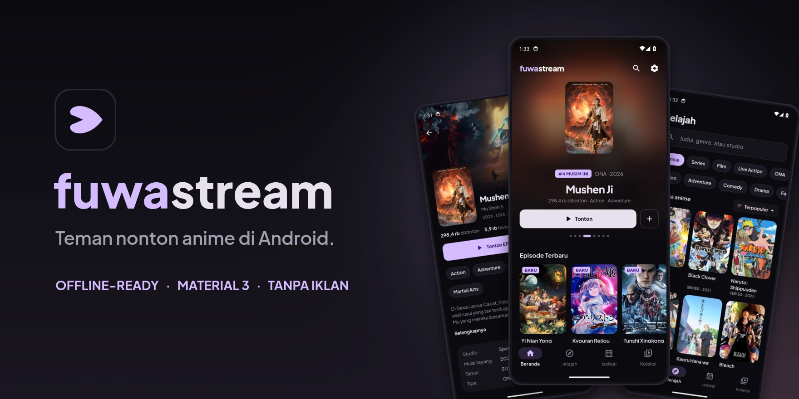

<br>

**Nonton anime dan baca manga dalam satu aplikasi Android yang rapi, cepat, dan tanpa iklan.**

<p>
  <a href="https://github.com/fuwanime/fuwastream/releases/latest"></a>
  
  <a href="./LICENSE"></a>
</p>

<p>
  <a href="https://github.com/fuwanime/fuwastream/stargazers"></a>
  <a href="https://github.com/fuwanime/fuwastream/network/members"></a>
  <a href="https://github.com/fuwanime/fuwastream/issues"></a>
  
  
</p>

[**Download APK**](https://github.com/fuwanime/fuwastream/releases/latest) &nbsp;·&nbsp; [**Gabung Komunitas**](https://chat.whatsapp.com/BD9q9veoNaAIhkdneKD4us) &nbsp;·&nbsp; [**Laporkan Bug**](https://github.com/fuwanime/fuwastream/issues)

<br>

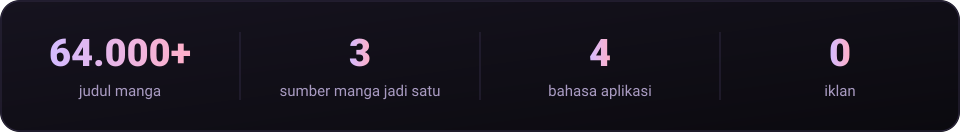

</div>

<p align="center">
  <a href="#tonton">Tonton</a> &nbsp;·&nbsp;
  <a href="#baca">Baca</a> &nbsp;·&nbsp;
  <a href="#temukan">Temukan</a> &nbsp;·&nbsp;
  <a href="#simpan">Simpan</a> &nbsp;·&nbsp;
  <a href="#punyamu">Punyamu</a> &nbsp;·&nbsp;
  <a href="#pasang">Pasang</a> &nbsp;·&nbsp;
  <a href="#dibuat-dengan">Teknologi</a>
</p>

> [!TIP]
> **Baru: WEBTOON jadi sumber manga keempat.** Webtoon Original dan Canvas berbahasa Indonesia kini bisa dicari, dibaca, dan diunduh dari tab Manga, tanpa pindah aplikasi. Lihat bagian [Baca](#baca).

## Tonton

<table>
  <tr>
    <td align="center" width="25%">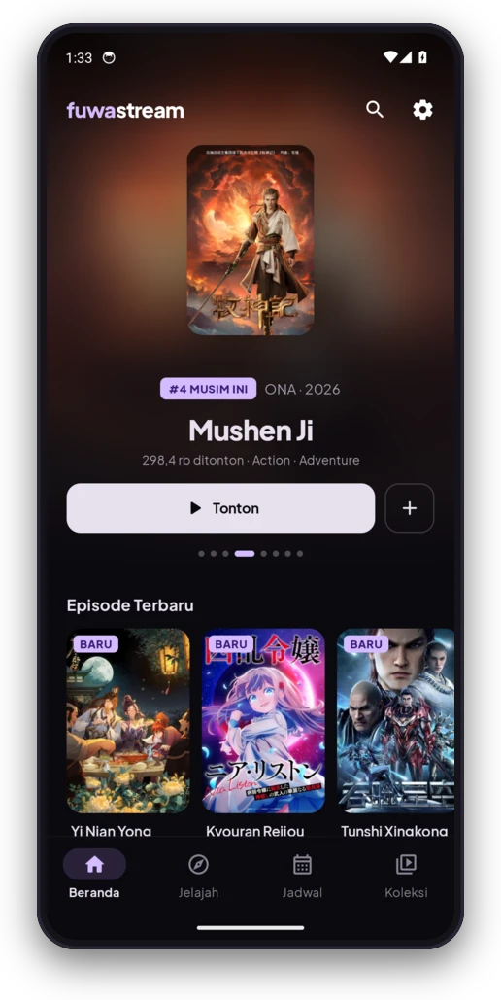<br><sub><b>Beranda</b><br>Sorotan musim ini</sub></td>
    <td align="center" width="25%">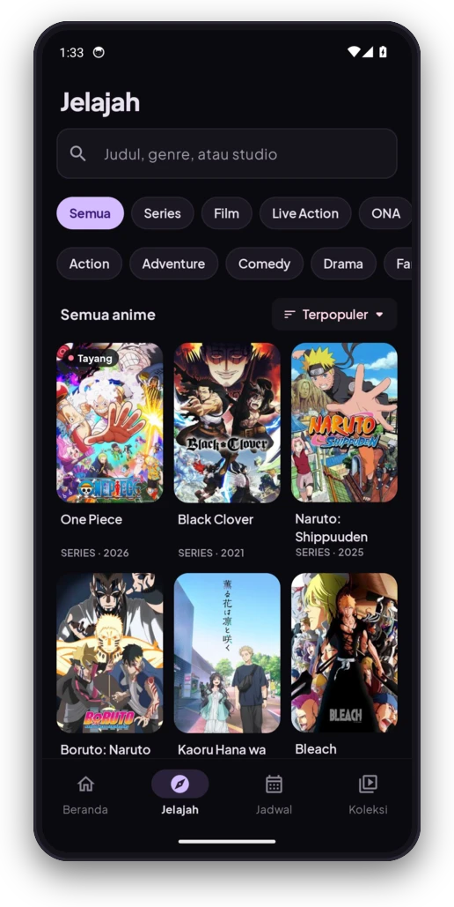<br><sub><b>Jelajah</b><br>Cari, filter, urutkan</sub></td>
    <td align="center" width="25%">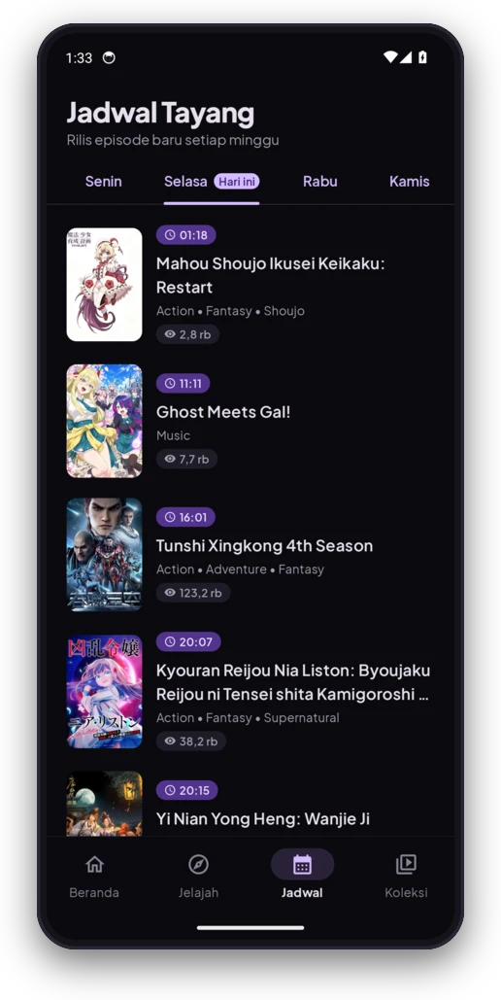<br><sub><b>Jadwal</b><br>Rilis per hari</sub></td>
    <td align="center" width="25%">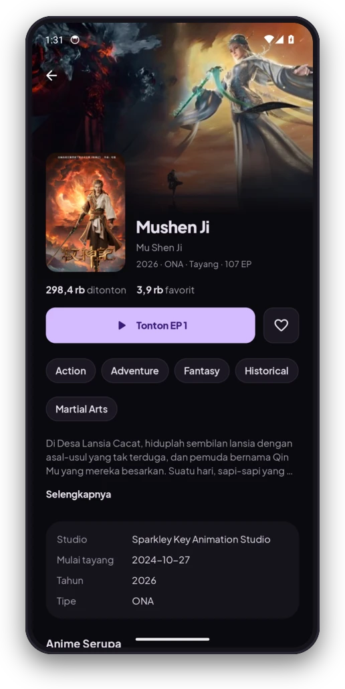<br><sub><b>Detail</b><br>Episode &amp; info lengkap</sub></td>
  </tr>
  <tr>
    <td align="center">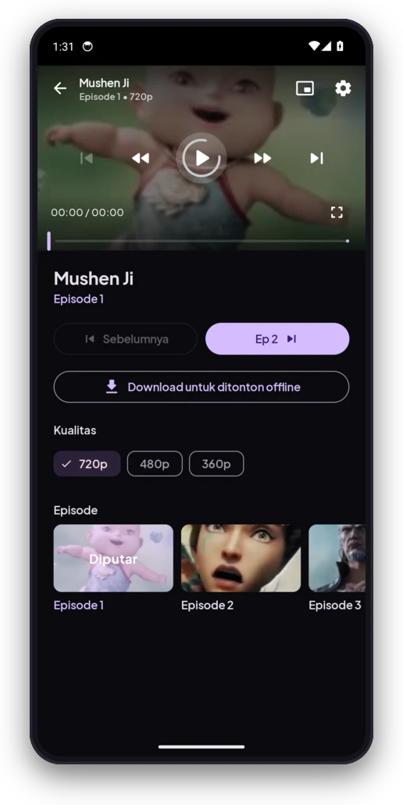<br><sub><b>Pemutar</b><br>Kualitas, PiP, gestur</sub></td>
    <td align="center">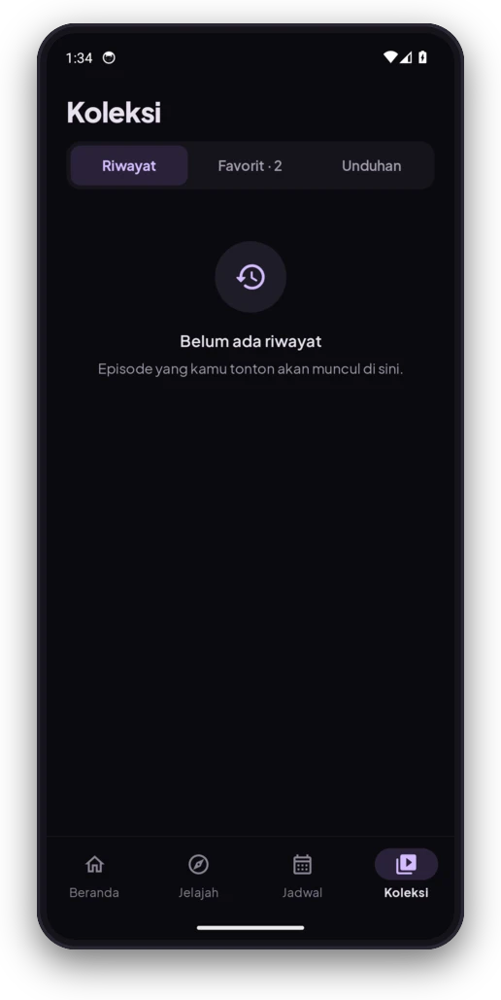<br><sub><b>Koleksi</b><br>Riwayat, favorit, unduhan</sub></td>
    <td align="center">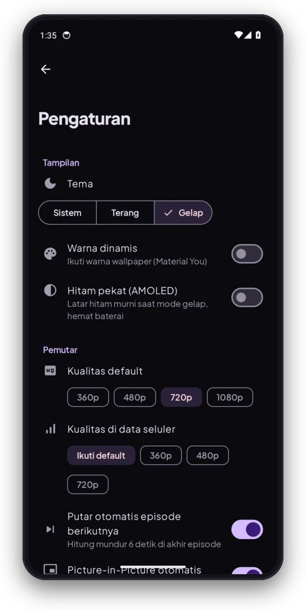<br><sub><b>Pengaturan</b><br>Atur sesukamu</sub></td>
    <td align="center">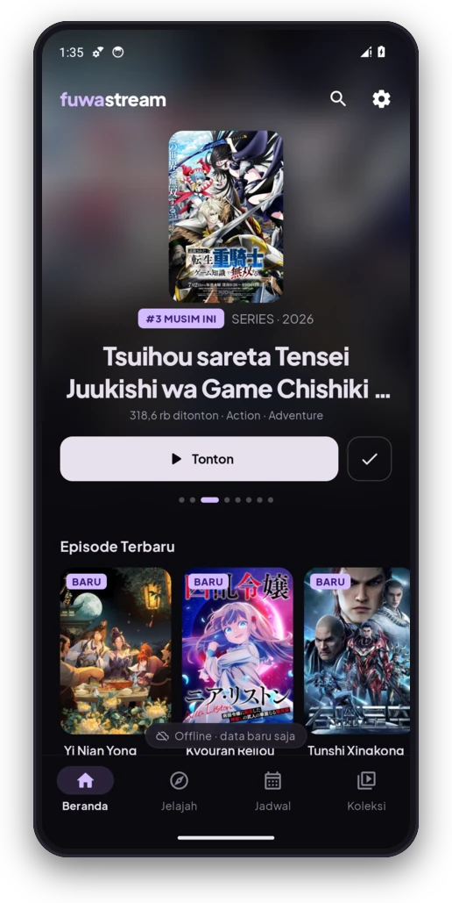<br><sub><b>Mode offline</b><br>Data terakhir tetap ada</sub></td>
  </tr>
</table>

## Fitur

<table>
  <tr>
    <td width="50%" valign="top">
      <h3>Temukan</h3>
      <ul>
        <li><b>Beranda sinematik</b> — sorotan musim ini, Lanjutkan Nonton, episode terbaru, Top 10 terpopuler, dan pintasan genre.</li>
        <li><b>Jelajah</b> — cari judul, genre, atau studio; filter tipe &amp; genre; urutkan populer, terbaru, atau A–Z.</li>
        <li><b>Jadwal tayang</b> — rilis per hari lengkap dengan jamnya.</li>
        <li><b>Anime serupa &amp; season terkait</b> — langsung dari halaman detail.</li>
        <li><b>Manga</b> — saklar Anime | Manga di Beranda &amp; Jelajah; baca chapter dari <a href="https://comix.ws">Comix</a> sebagai katalog utama plus sumber Indonesia <a href="https://shinigami.asia">Shinigami</a>, <a href="https://komiku.org">Komiku</a>, dan WEBTOON, dengan reader scroll vertikal, lanjut baca, favorit, unduhan, serta terjemahan chapter ke Bahasa Indonesia via IsManga untuk chapter Comix.</li>
      </ul>
    </td>
    <td width="50%" valign="top">
      <h3>Tonton</h3>
      <ul>
        <li><b>Pemutar Media3</b> — pilih kualitas, kecepatan 0,5×–2×, mode pas/isi layar.</li>
        <li><b>Gestur</b> — ketuk dua kali untuk maju/mundur, geser untuk kecerahan &amp; volume.</li>
        <li><b>Lewati OP</b> — otomatis, atau tombol <b>+85 detik</b> yang bisa dimatikan.</li>
        <li><b>Lanjut otomatis</b> ke episode berikutnya dan <b>Picture-in-Picture</b>.</li>
      </ul>
    </td>
  </tr>
  <tr>
    <td width="50%" valign="top">
      <h3>Simpan</h3>
      <ul>
        <li><b>Koleksi</b> — riwayat per hari dengan sisa waktu tontonan, favorit, dan unduhan.</li>
        <li><b>Download offline</b> — pilih kualitas, opsi hanya lewat Wi-Fi.</li>
        <li><b>Notifikasi episode baru</b> untuk anime favoritmu.</li>
      </ul>
    </td>
    <td width="50%" valign="top">
      <h3>Personal</h3>
      <ul>
        <li><b>Tema</b> — sistem, terang, gelap, hitam AMOLED, dan Material You.</li>
        <li><b>Kualitas default</b> terpisah untuk Wi-Fi dan data seluler.</li>
        <li><b>Update di dalam aplikasi</b> — diberi tahu saat rilis baru tersedia.</li>
      </ul>
    </td>
  </tr>
</table>

## Baca

<table>
  <tr>
    <td valign="top">
      <p><b>Satu judul, empat sumber.</b> FuwaStream mencari judul yang sama di MangaDex, Shinigami, Komiku, dan WEBTOON, lalu menggabungkannya jadi satu daftar chapter. Tiap chapter diambil dari sumber yang bisa dibaca dan paling bagus.</p>
      <p><b>WEBTOON resmi.</b> Katalog Original dan Canvas berbahasa Indonesia: sampul, sinopsis, genre, daftar episode lengkap, dan panel vertikal langsung di reader. Judul WEBTOON yang sama juga ditemukan di sumber lain, begitu pula sebaliknya.</p>
      <p><b>Pilih bahasanya.</b> Indonesia, Inggris, atau Raw, dan hanya bahasa yang benar-benar ada untuk judul itu yang ditampilkan.</p>
      <p><b>Manga, Manhwa, Manhua</b> bisa difilter langsung di tab Manga. Judul lama yang sudah tamat ikut tersedia dari arsip Komiku.</p>
      <p><b>Reader vertikal</b> dengan pemilih chapter, tombol Prev dan Next, lanjut dari halaman terakhir, dan mode hemat data. Konten dewasa hanya muncul kalau kamu nyalakan di Pengaturan.</p>
    </td>
    <td width="36%" valign="top">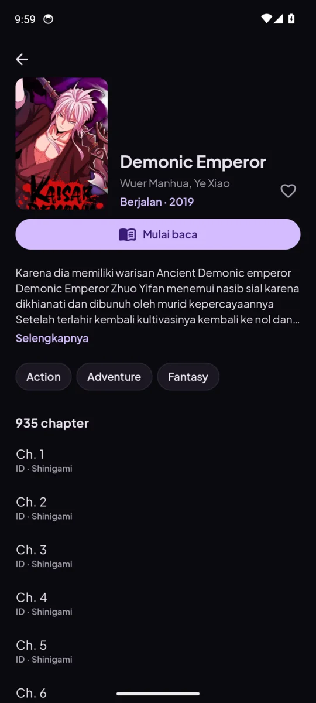</td>
  </tr>
</table>

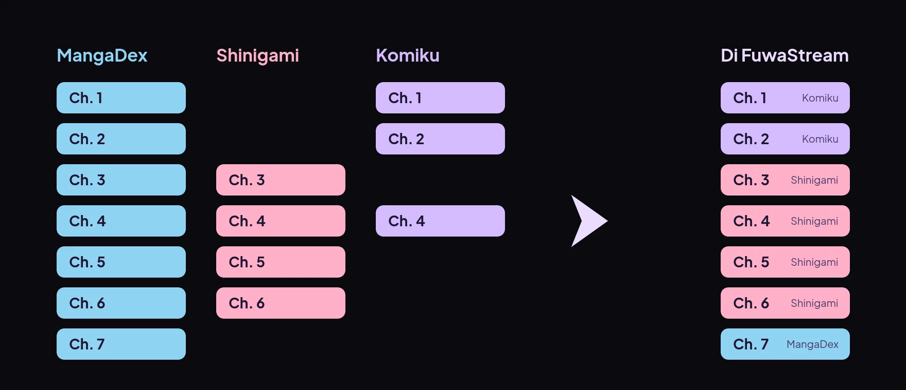

<sub>Urutan prioritas tiap chapter: yang bisa dibaca di aplikasi lebih dulu, lalu Shinigami, Komiku, MangaDex, dan WEBTOON. Diagram di atas belum menampilkan WEBTOON.</sub>

## Temukan

<table>
  <tr>
    <td width="36%" valign="top">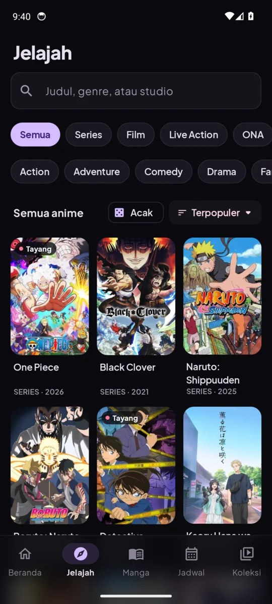</td>
    <td valign="top">
      <p><b>Beranda</b> dibuka dengan sorotan musim ini, lalu Lanjutkan Nonton, episode terbaru, dan Top 10.</p>
      <p><b>Jelajah</b> mencari judul, genre, atau studio, dengan filter tipe (Series, Film, ONA, OVA, Live Action) dan urutan populer, terbaru, atau A–Z.</p>
      <p><b>Anime serupa dan season berikutnya</b> muncul di halaman detail, jadi kamu tidak perlu mencari lagi.</p>
      <p><b>Pencarian manga</b> menampilkan satu hasil per judul walaupun judul itu ada di beberapa sumber, termasuk WEBTOON.</p>
    </td>
  </tr>
</table>

## Simpan

<table>
  <tr>
    <td valign="top">
      <p><b>Unduh episode dan chapter</b> untuk ditonton atau dibaca tanpa internet: satu episode, semua episode, satu chapter, atau rentang 1–100 sekaligus.</p>
      <p><b>Simpan ke mana?</b> Setiap kali mengunduh kamu bisa memilih: di dalam aplikasi, atau ke folder pilihanmu. Di folder pilihan, tiap judul punya foldernya sendiri dan nama file urut, misalnya <code>Judul - Ep 01 (720p).mkv</code>.</p>
      <p><b>Koleksi</b> menyatukan riwayat, favorit, manga, dan unduhan. Semuanya bisa dibackup ke folder pilihanmu dan dipulihkan di HP lain.</p>
      <p><b>Tahan offline.</b> Layar yang pernah dibuka langsung tampil dari data terakhir, lalu diperbarui diam-diam begitu internet kembali.</p>
    </td>
    <td width="36%" valign="top">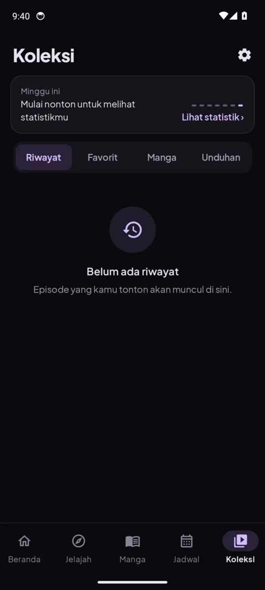</td>
  </tr>
</table>

## Punyamu

<table>
  <tr>
    <td width="36%" valign="top">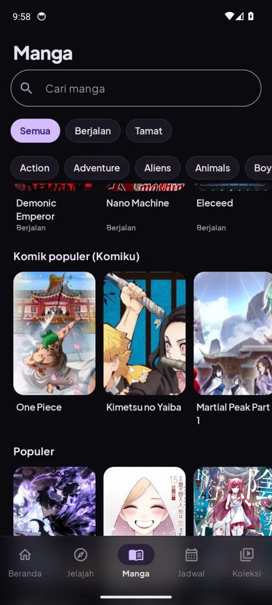</td>
    <td valign="top">
      <p><b>Tema</b> mengikuti sistem, terang, gelap, hitam AMOLED, atau warna Material You dari wallpaper.</p>
      <p><b>Statistik nonton:</b> total waktu, episode selesai, minggu aktif berturut-turut, genre teratas, dan rekap yang bisa dibagikan.</p>
      <p><b>Empat bahasa aplikasi:</b> Indonesia, Melayu, Inggris, dan Mandarin (Sederhana). Terjemahan Melayu dan Mandarin dibuat dengan mesin; koreksi dari penutur asli sangat diterima.</p>
      <p><b>Update di dalam aplikasi</b> memberi tahu saat ada rilis baru.</p>
    </td>
  </tr>
</table>

## Pasang

<ol>
  <li>Buka halaman <a href="https://github.com/fuwanime/fuwastream/releases/latest"><b>rilis terbaru</b></a>.</li>
  <li>Unduh file <b>APK</b> di bagian <b>Assets</b>.</li>
  <li>Buka APK di HP dan izinkan instalasi dari sumber itu bila diminta.</li>
  <li>Buka FuwaStream.</li>
</ol>

> [!IMPORTANT]
> Unduh APK **hanya** dari halaman rilis resmi repository ini. Butuh **Android 7.0 (API 24)** atau lebih baru.

## Dibuat dengan

Kotlin dan Jetpack Compose dengan Material 3, Media3 ExoPlayer untuk pemutar, Room dan DataStore untuk data di HP, WorkManager untuk unduhan dan backup, Retrofit, OkHttp, dan Moshi untuk jaringan, serta Coil 3 untuk gambar. Build dan rilis berjalan di GitHub Actions.

| Sumber data | Dipakai untuk |
| :--- | :--- |
| Animein | Katalog, jadwal, dan sumber pemutaran anime |
| AniList, AniSkip | Info tambahan anime dan penanda opening |
| MangaDex | Manga multi-bahasa (Indonesia, Inggris, Raw) |
| Shinigami, Komiku | Manga berbahasa Indonesia |
| WEBTOON | Webtoon Original dan Canvas berbahasa Indonesia (pencarian, detail, episode, dan panel) |

<details>
<summary><b>Build dari source</b></summary>

<br>

Butuh JDK 17+, Android SDK 36, dan Gradle yang kompatibel.

```bash
git clone https://github.com/fuwanime/fuwastream.git
cd fuwastream
gradle testDebugUnitTest assembleDebug
```

APK debug ada di `app/build/outputs/apk/debug/app-debug.apk`.

| Pemicu GitHub Actions | Hasil |
|---|---|
| Push ke `main` / PR | Menjalankan unit test dan kompilasi APK sebagai artefak verifikasi CI |
| Rilis SemVer manual (`workflow_dispatch`) | Bump versi SemVer (Major/Minor/Patch) dan publikasi rilis di [Releases](https://github.com/fuwanime/fuwastream/releases) |
| Tag `v*.*.*` | Build rilis dan publikasi otomatis sesuai tag SemVer |
| Manual · `smoke` / `qa` | Uji di emulator Android dengan tangkapan layar dan rekaman |
| Manual · `profile` | Membuat ulang *baseline profile* untuk optimasi performa *cold start* |
</details>

<details>
<summary><b>Struktur proyek</b></summary>

<br>

```text
com.fuwanime
├── data/
│   ├── remote/       # API anime, DTO, cache dan status jaringan
│   ├── manga/        # MangaDex, Shinigami, Komiku, WEBTOON, gabung sumber, unduhan manga
│   ├── meta/         # AniList dan AniSkip
│   ├── backup/       # Backup dan pulihkan data
│   └── local/        # Room dan DataStore
├── playback/         # Layanan pemutaran dan audio latar
├── ui/               # Paket per layar (Screen + ViewModel)
│   ├── components/   # Komponen UI yang dipakai ulang
│   ├── manga/        # Tab, detail, dan reader manga
│   ├── navigation/   # Navigasi aplikasi
│   └── theme/        # Tema, warna, tipografi
└── util/             # Helper dan utilitas
```

</details>

## Tim

| Nama | Peran |
| :--- | :--- |
| **YuzakiNetwork (Haruka Fuyune)** | Pendiri dan admin proyek.<br>• **Brand dan identitas**: ikon peluncur *petal-play*, ikon 512px, *wordmark* FuwaStream, *rebrand* FuwaNime ke FuwaStream, lisensi GPL-3.0.<br>• **Legal dan privasi**: Kebijakan Privasi, Ketentuan Layanan, *age-gate* 13+, hapus semua data, dokumen kepatuhan.<br>• **Fondasi aplikasi**: struktur proyek awal, pengecek *update* dengan *changelog*, notifikasi episode baru, anime serupa, filter tipe konten di Jelajah, unduhan massal awal.<br>• **Build**: *versionCode* deterministik untuk F-Droid, *smoke test* di branch `qa-smoke`. |
| **Andra (SakamotoMrX)** | Pengelola dan kontributor utama (paling banyak *commit*).<br>• **UI/UX**: antarmuka sinematik Material 3, tab Koleksi, grafik waktu tonton, tema Material You (terang, gelap, AMOLED), *navigation rail* layar lebar, serta audit UI terbaru (katalog, judul, tipe, aksesibilitas Pengaturan).<br>• **Aksesibilitas dan bahasa**: dukungan TalkBack, batas skala font, 4 bahasa (Indonesia, Melayu, Inggris, Mandarin).<br>• **Manga**: pencarian lintas sumber (Shinigami, Komiku, MangaPark, KakaManga, WEBTOON), satu daftar chapter per judul dengan chip ID/EN/Raw, filter Manga/Manhwa/Manhua, *reader* vertikal dengan DoH, unduh chapter atau rentang chapter, baca *offline*, lanjut otomatis ke chapter berikutnya, jembatan dari halaman anime ke manga sumbernya.<br>• **Pemutar dan unduhan**: audio latar, PiP, AniSkip, *gesture* kecepatan hingga 4x, buka di pemutar eksternal, unduh dengan pilihan rentang episode, satu folder per judul via SAF.<br>• **Anime dan aplikasi**: karakter dan pengisi suara, widget *Lanjutkan* (anime dan manga), pembaruan satu ketukan di dalam aplikasi, pencadangan dan pemulihan data, arsitektur *cache-first*.<br>• **Rilis dan QA**: alur rilis SemVer, *baseline profile* otomatis, tes unit dan *smoke test* emulator, pengelola rilis dan *review* PR. |
| **Seiaaxn (Chiel)** | Kontributor.<br>• **Gamifikasi dan profil**: XP dan level, 50 *rank tag*, papan misi 3 hari, bingkai avatar, akun dan profil lokal (PR #32).<br>• **Sumber**: sumber Animekompi (anime, jadwal, unduhan), LINE Webtoon sebagai sumber manga keempat (#37).<br>• **Anime**: trailer AniList dan *thumbnail* cadangan di halaman detail (#55), ide dan implementasi awal karakter dan pengisi suara (#45).<br>• **Build**: pembaruan KSP agar CI stabil (#36), penyesuaian `build.yml` dan `release.yml`. |
| **LT-SYAII (BANG SYAII)** | Kontributor.<br>• **Sumber anime**: integrasi Kuramanime (pencarian, detail, episode, pemutaran), statistik penonton AniList dan *thumbnail* episode.<br>• **Terjemahan manga**: terjemahan chapter ke Bahasa Indonesia (IsManga dan MangaTranslate), berjalan di latar belakang, OCR dan *retry*, serta *translator* cadangan.<br>• **Reader dan manga**: gulir otomatis dan lanjut ke chapter berikutnya, *skeleton loading*, perbaikan pemuatan chapter, pembersihan genre dan filter Jelajah.<br>• **Notifikasi**: cek rilis episode dan manga tiap 15 menit, perbaikan deteksi rilis, notifikasi pembaruan aplikasi.<br>• **Konten dewasa**: toggle konten dewasa juga untuk anime.<br>• **CI rilis**: APK universal, verifikasi kunci tanda tangan resmi, *pin* aksi ke SHA. |

Mau ikut membantu? Fork repository ini, buat branch, jalankan `gradle testDebugUnitTest`, lalu kirim Pull Request dengan penjelasan singkat dan cara mengujinya. Ide fitur dan laporan bug masuk ke [Issues](https://github.com/fuwanime/fuwastream/issues).

## Catatan konten

1. **Fork** repository ini dan buat branch untuk perubahanmu.
2. Uji perubahanmu (`gradle testDebugUnitTest`).
3. Kirim **Pull Request** dengan penjelasan singkat dan cara mengujinya.

Punya ide fitur atau menemukan bug? [Buat Issue](https://github.com/fuwanime/fuwastream/issues) — cek dulu apakah sudah pernah dilaporkan.

## Catatan konten

> [!NOTE]
> FuwaStream adalah aplikasi klien dan **tidak meng-host file video maupun gambar manga**. Informasi dan sumber pemutaran berasal dari API atau layanan pihak ketiga, sehingga ketersediaan konten bergantung pada layanan tersebut. Pengguna bertanggung jawab mematuhi hukum, hak cipta, dan ketentuan layanan yang berlaku di wilayahnya. Nama, logo, dan aset pihak ketiga tetap milik pemegang haknya. Data dan gambar manga berasal dari [Comix](https://comix.ws), [Shinigami](https://shinigami.asia), [Komiku](https://komiku.org), dan WEBTOON beserta grup scanlation/penyedia masing-masing; FuwaStream tidak menampilkan iklan. Terjemahan chapter Comix ke Bahasa Indonesia menggunakan layanan IsManga (server-side) dan kualitasnya dapat berbeda dari terjemahan resmi.

## Privasi &amp; kepatuhan

[Kebijakan Privasi](./docs/legal/privacy.md) · [Ketentuan Layanan](./docs/legal/terms.md) · [Audit SDK Pihak Ketiga](./docs/third-party-sdk-audit.md)

Kode sumber dilisensikan di bawah **[GNU General Public License v3.0](./LICENSE)**. Lisensi kode tidak memberikan hak atas nama, logo, merek, maupun aset FuwaStream.

Font **Comic Neue** dibuat oleh Craig Rozynski dan dilisensikan di bawah [SIL Open Font License 1.1](https://github.com/crozynski/comicneue/blob/master/OFL.txt). Salinan lisensi disertakan di `app/src/main/assets/licenses/comic_neue_ofl.txt` (jika tersedia).

---

<div align="center">


**Dibuat dengan cinta untuk para pecinta anime.**

<sub>Kalau FuwaStream bermanfaat buatmu, beri bintang pada repository ini — itu sangat membantu!</sub>

[GitHub](https://github.com/fuwanime/fuwastream) · [Komunitas WhatsApp](https://chat.whatsapp.com/BD9q9veoNaAIhkdneKD4us) · [Releases](https://github.com/fuwanime/fuwastream/releases)

</div>
