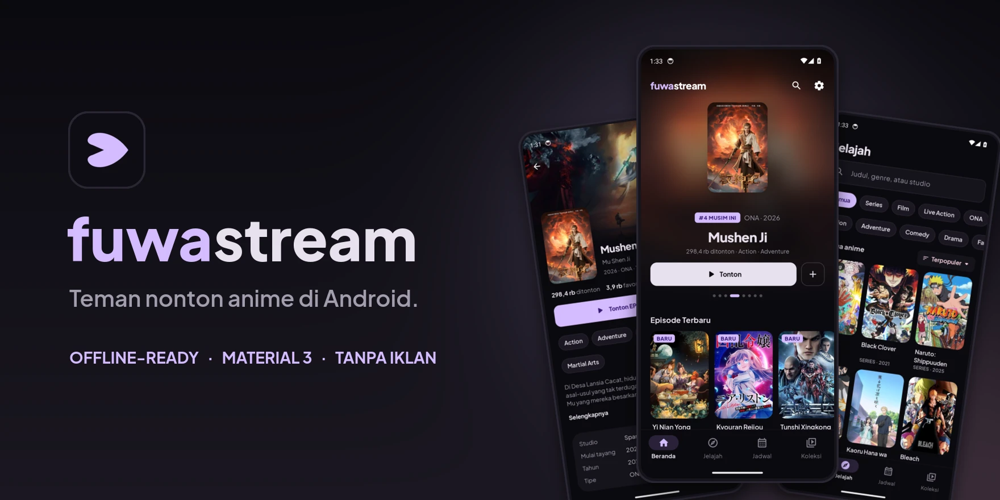
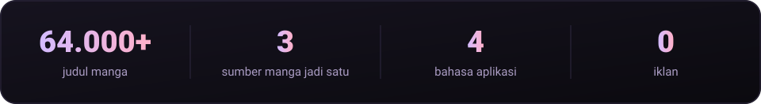
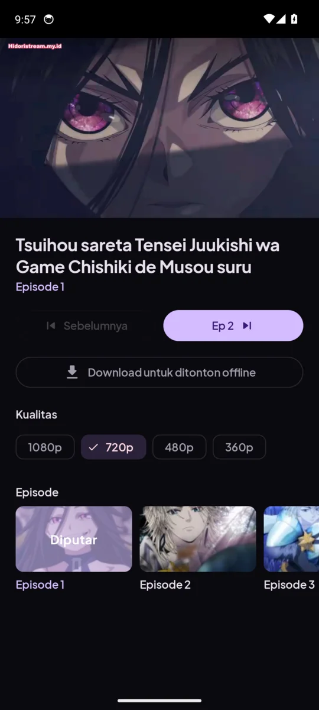
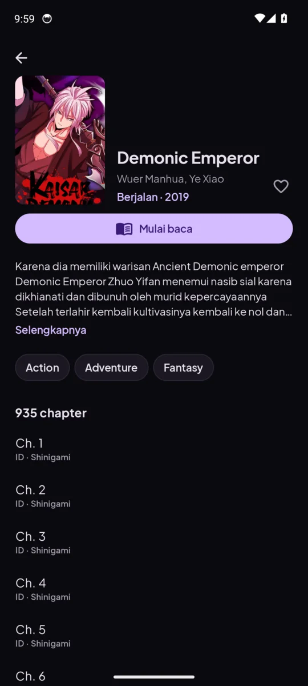
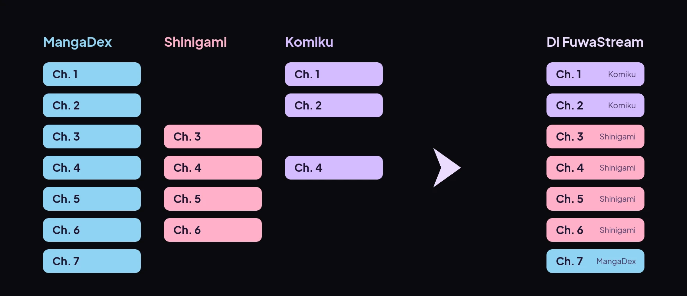
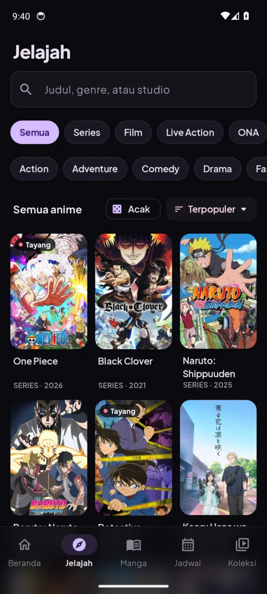
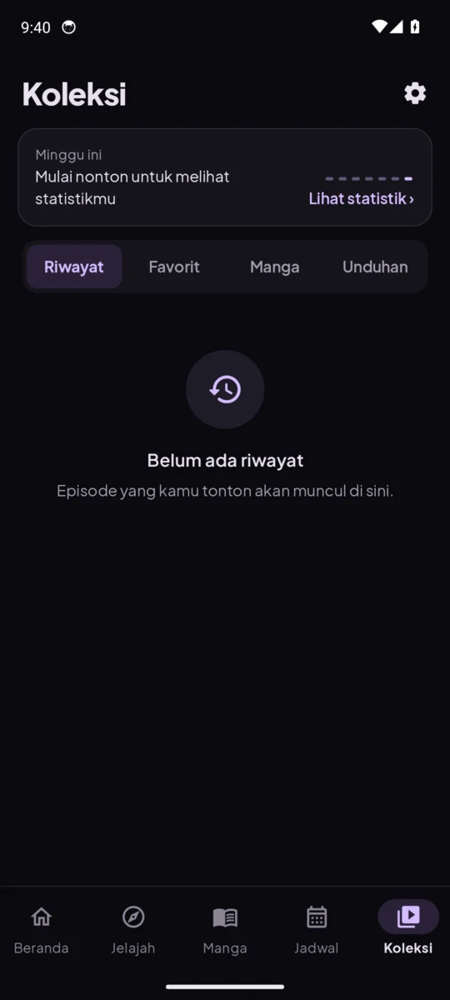
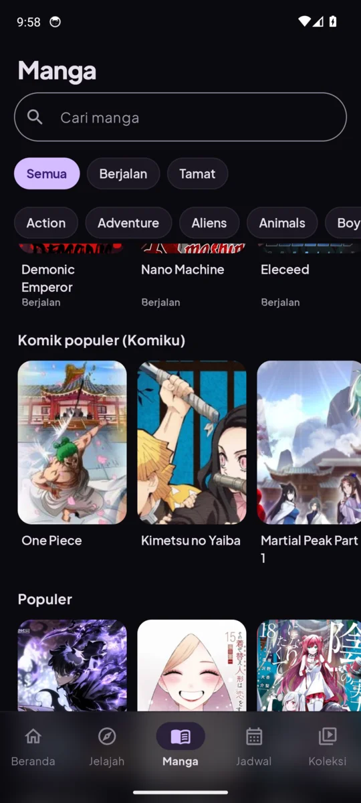
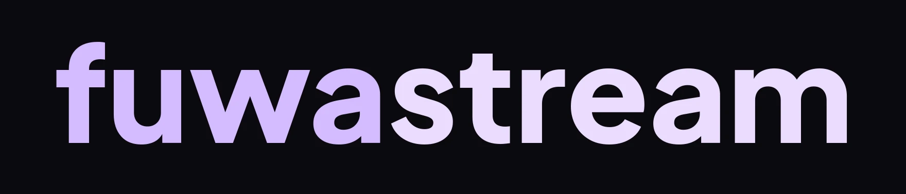

<div align="center">



<br>

**Nonton anime dan baca manga dalam satu aplikasi Android yang rapi, cepat, dan tanpa iklan.**

<p>
  <a href="https://github.com/fuwanime/fuwastream/releases/latest"></a>
  
  <a href="./LICENSE"></a>
</p>

<p>
  <a href="https://github.com/fuwanime/fuwastream/stargazers"></a>
  <a href="https://github.com/fuwanime/fuwastream/network/members"></a>
  <a href="https://github.com/fuwanime/fuwastream/issues"></a>
  
</p>

[**Download APK**](https://github.com/fuwanime/fuwastream/releases/latest) &nbsp;·&nbsp; [**Gabung Komunitas**](https://chat.whatsapp.com/BD9q9veoNaAIhkdneKD4us) &nbsp;·&nbsp; [**Laporkan Bug**](https://github.com/fuwanime/fuwastream/issues)

<br>



</div>

## Tonton

<table>
  <tr>
    <td width="36%" valign="top"></td>
    <td valign="top">
      <p><b>Pemutar yang tidak merepotkan.</b> Pilih kualitas 360p sampai 1080p, kecepatan 0,5× sampai 2×, dan mode pas atau isi layar. Kualitas bawaan bisa dibedakan untuk Wi-Fi dan data seluler.</p>
      <p><b>Gestur di layar penuh.</b> Ketuk dua kali untuk maju atau mundur, geser untuk kecerahan dan volume. Saat video memuat, yang tampil hanya lingkaran memuat; tombol muncul saat layar diketuk.</p>
      <p><b>Lewati opening</b> otomatis berkat data AniSkip, atau pakai tombol <b>+85 dtk</b>. Episode berikutnya diputar sendiri, video bisa jalan di <b>Picture-in-Picture</b>, dan suaranya tetap terdengar saat layar mati.</p>
      <p><b>Jadwal tayang</b> per hari dengan jam rilis, plus notifikasi episode baru untuk anime favoritmu.</p>
    </td>
  </tr>
</table>

## Baca

<table>
  <tr>
    <td valign="top">
      <p><b>Satu judul, tiga sumber.</b> FuwaStream mencari judul yang sama di MangaDex, Shinigami, dan Komiku, lalu menggabungkannya jadi satu daftar chapter. Tiap chapter diambil dari sumber yang bisa dibaca dan paling bagus.</p>
      <p><b>Pilih bahasanya.</b> Indonesia, Inggris, atau Raw, dan hanya bahasa yang benar-benar ada untuk judul itu yang ditampilkan.</p>
      <p><b>Manga, Manhwa, Manhua</b> bisa difilter langsung di tab Manga. Judul lama yang sudah tamat ikut tersedia dari arsip Komiku.</p>
      <p><b>Reader vertikal</b> dengan pemilih chapter, tombol Prev dan Next, lanjut dari halaman terakhir, dan mode hemat data. Konten dewasa hanya muncul kalau kamu nyalakan di Pengaturan.</p>
    </td>
    <td width="36%" valign="top"></td>
  </tr>
</table>



<sub>Urutan prioritas tiap chapter: yang bisa dibaca di aplikasi lebih dulu, lalu Shinigami, Komiku, dan MangaDex.</sub>

## Temukan

<table>
  <tr>
    <td width="36%" valign="top"></td>
    <td valign="top">
      <p><b>Beranda</b> dibuka dengan sorotan musim ini, lalu Lanjutkan Nonton, episode terbaru, dan Top 10.</p>
      <p><b>Jelajah</b> mencari judul, genre, atau studio, dengan filter tipe (Series, Film, ONA, OVA, Live Action) dan urutan populer, terbaru, atau A–Z.</p>
      <p><b>Anime serupa dan season berikutnya</b> muncul di halaman detail, jadi kamu tidak perlu mencari lagi.</p>
      <p><b>Pencarian manga</b> menampilkan satu hasil per judul walaupun judul itu ada di beberapa sumber.</p>
    </td>
  </tr>
</table>

## Simpan

<table>
  <tr>
    <td valign="top">
      <p><b>Unduh episode dan chapter</b> untuk ditonton atau dibaca tanpa internet: satu episode, semua episode, satu chapter, atau rentang 1–100 sekaligus.</p>
      <p><b>Simpan ke mana?</b> Setiap kali mengunduh kamu bisa memilih: di dalam aplikasi, atau ke folder pilihanmu. Di folder pilihan, tiap judul punya foldernya sendiri dan nama file urut, misalnya <code>Judul - Ep 01 (720p).mkv</code>.</p>
      <p><b>Koleksi</b> menyatukan riwayat, favorit, manga, dan unduhan. Semuanya bisa dibackup ke folder pilihanmu dan dipulihkan di HP lain.</p>
      <p><b>Tahan offline.</b> Layar yang pernah dibuka langsung tampil dari data terakhir, lalu diperbarui diam-diam begitu internet kembali.</p>
    </td>
    <td width="36%" valign="top"></td>
  </tr>
</table>

## Punyamu

<table>
  <tr>
    <td width="36%" valign="top"></td>
    <td valign="top">
      <p><b>Tema</b> mengikuti sistem, terang, gelap, hitam AMOLED, atau warna Material You dari wallpaper.</p>
      <p><b>Statistik nonton:</b> total waktu, episode selesai, minggu aktif berturut-turut, genre teratas, dan rekap yang bisa dibagikan.</p>
      <p><b>Empat bahasa aplikasi:</b> Indonesia, Melayu, Inggris, dan Mandarin (Sederhana). Terjemahan Melayu dan Mandarin dibuat dengan mesin; koreksi dari penutur asli sangat diterima.</p>
      <p><b>Update di dalam aplikasi</b> memberi tahu saat ada rilis baru.</p>
    </td>
  </tr>
</table>

## Pasang

<ol>
  <li>Buka halaman <a href="https://github.com/fuwanime/fuwastream/releases/latest"><b>rilis terbaru</b></a>.</li>
  <li>Unduh file <b>APK</b> di bagian <b>Assets</b>.</li>
  <li>Buka APK di HP dan izinkan instalasi dari sumber itu bila diminta.</li>
  <li>Buka FuwaStream.</li>
</ol>

> [!IMPORTANT]
> Unduh APK **hanya** dari halaman rilis resmi repository ini. Butuh **Android 7.0 (API 24)** atau lebih baru.

## Dibuat dengan

Kotlin dan Jetpack Compose dengan Material 3, Media3 ExoPlayer untuk pemutar, Room dan DataStore untuk data di HP, WorkManager untuk unduhan dan backup, Retrofit, OkHttp, dan Moshi untuk jaringan, serta Coil 3 untuk gambar. Build dan rilis berjalan di GitHub Actions.

| Sumber data | Dipakai untuk |
| :--- | :--- |
| Animein | Katalog, jadwal, dan sumber pemutaran anime |
| AniList, AniSkip | Info tambahan anime dan penanda opening |
| MangaDex | Manga multi-bahasa (Indonesia, Inggris, Raw) |
| Shinigami, Komiku | Manga berbahasa Indonesia |

<details>
<summary><b>Build dari source</b></summary>

<br>

Butuh JDK 17+, Android SDK 36, dan Gradle yang kompatibel.

```bash
git clone https://github.com/fuwanime/fuwastream.git
cd fuwastream
gradle testDebugUnitTest assembleDebug
```

APK debug ada di `app/build/outputs/apk/debug/app-debug.apk`.

| Pemicu GitHub Actions | Hasil |
|---|---|
| Push ke `main` / PR | Menjalankan unit test dan kompilasi APK/AAB sebagai artefak verifikasi CI |
| Rilis SemVer manual (`workflow_dispatch`) | Bump versi SemVer (Major/Minor/Patch) dan publikasi rilis di [Releases](https://github.com/fuwanime/fuwastream/releases) |
| Tag `v*.*.*` | Build rilis dan publikasi otomatis sesuai tag SemVer |
| Manual · `smoke` / `qa` | Uji di emulator Android dengan tangkapan layar dan rekaman |
| Manual · `profile` | Membuat ulang *baseline profile* untuk optimasi performa *cold start* |
</details>

<details>
<summary><b>Struktur proyek</b></summary>

<br>

```text
com.fuwanime
├── data/
│   ├── remote/       # API anime, DTO, cache dan status jaringan
│   ├── manga/        # MangaDex, Shinigami, Komiku, gabung sumber, unduhan manga
│   ├── meta/         # AniList dan AniSkip
│   ├── backup/       # Backup dan pulihkan data
│   └── local/        # Room dan DataStore
├── playback/         # Layanan pemutaran dan audio latar
├── ui/               # Paket per layar (Screen + ViewModel)
│   ├── components/   # Komponen UI yang dipakai ulang
│   ├── manga/        # Tab, detail, dan reader manga
│   ├── navigation/   # Navigasi aplikasi
│   └── theme/        # Tema, warna, tipografi
└── util/             # Helper dan utilitas
```

</details>

## Tim

| Nama | Peran |
| :--- | :--- |
| **YuzakiNetwork (Haruka Fuyune)** | Pendiri dan admin proyek:<br>• **Brand dan identitas visual**: Desain ikon peluncur geometris (*petal-play*), *mask preview*, ikon 512px, dan *wordmark* FuwaStream.<br>• **Legal, privasi, dan kepatuhan**: Dokumen kepatuhan Play Store, Kebijakan Privasi, Ketentuan Layanan, *age-gate* 13+, dan fungsi hapus semua data.<br>• **Fitur anime dan katalog**: Pengecek *update* otomatis dengan *in-app changelog*, notifikasi episode baru, rekomendasi anime serupa (dengan *fallback cache*), filter tipe konten di Jelajah (Series, Film, ONA, OVA, Special), dan unduhan massal awal.<br>• **Infrastruktur dan build**: Konfigurasi awal proyek, lisensi GPL-3.0, *build* bundle AAB, alur smoke test di branch qa-smoke, dan formula *versionCode* deterministik untuk F-Droid. |
| **Andra** | Kolaborator dan kontributor:<br>• **UI/UX dan desain sinematik**: *Redesign* antarmuka sinematik Material 3 (Beranda *ambient blur*, Jelajah *multi-chip* dan *collapsing header*, detail sinematik dengan *poster tinting*), tab Koleksi dengan badge "N baru" dan multi-pilih, grafik waktu tonton 7 hari, kartu rekap statistik, serta adaptasi tema Material You (terang, gelap, AMOLED).<br>• **Aksesibilitas dan multi-bahasa**: Dukungan penuh TalkBack (*merged nodes* dan label deskriptif), batas skala font 1.3x tanpa teks terpotong, tata letak layar lebar (*navigation rail*), serta pelokalan 4 bahasa (Indonesia, Melayu, Inggris, Mandarin).<br>• **Ekosistem manga**: Integrasi multi-sumber (MangaDex, Shinigami, Komiku 8.000+ judul), penggabung daftar chapter lintas sumber dengan filter bahasa (ID, EN, Raw) dan kategori (Manga, Manhwa, Manhua), *vertical reader* dengan DNS-over-HTTPS (DoH) untuk membuka blokir ISP, serta antrean unduh chapter *offline*.<br>• **Pemutar video (Media3 ExoPlayer)**: Audio latar belakang (*MediaSessionService*) saat layar mati atau di latar belakang, Picture-in-Picture (PiP) adaptif, integrasi AniSkip (otomatis/tombol +85 dtk), *gesture* layar penuh, dan tampilan bersih saat *buffering*.<br>• **Data, offline, dan penyimpanan**: Arsitektur *cache-first* (tahan *offline*), pencadangan dan pemulihan data lokal (Format v2), pemilihan folder unduhan eksternal via Storage Access Framework (SAF), serta widget *Glance* dan *Dynamic Shortcuts* di layar utama.<br>• **Infrastruktur, CI, dan QA**: *Suite smoke test* dan skenario QA komprehensif di emulator Android, generator Baseline Profile otomatis di CI, alur rilis SemVer terstandarisasi, dan dokumentasi aset resolusi tinggi. |
| **BANG SYAII (LT-SYAII)** | Kontributor:<br>• **Sumber & penemuan anime**: Integrasi sumber Kuramanime (pencarian, detail, episode, pemutaran native) dan penyatuan hasil ke daftar anime utama di Jelajah.<br>• **Notifikasi rilis**: Perbaikan deteksi rilis manga (`readableAt`) dan episode anime (penyegaran cache/penyelesaian status) agar notifikasi tidak macet, serta notifikasi pembaruan aplikasi (cek saat dibuka dan WorkManager berkala).<br>• **Konten dewasa**: Perluasan toggle konten dewasa ke anime (filter genre eksplisit Ecchi/Erotica/Hentai), sinkron dengan preferensi manga dan perilaku katalog/daftar terkait. |

Mau ikut membantu? Fork repository ini, buat branch, jalankan `gradle testDebugUnitTest`, lalu kirim Pull Request dengan penjelasan singkat dan cara mengujinya. Ide fitur dan laporan bug masuk ke [Issues](https://github.com/fuwanime/fuwastream/issues).

## Catatan konten

FuwaStream adalah aplikasi klien dan **tidak meng-host video maupun gambar manga**. Informasi dan sumber pemutaran datang dari layanan pihak ketiga, jadi ketersediaannya bergantung pada layanan tersebut. Pengguna bertanggung jawab mematuhi hukum, hak cipta, dan ketentuan layanan di wilayahnya. Nama, logo, dan aset pihak ketiga tetap milik pemegang haknya; gambar manga berasal dari MangaDex, Shinigami, dan Komiku beserta grup scanlation masing-masing.

[Kebijakan Privasi](./docs/legal/privacy.md) · [Ketentuan Layanan](./docs/legal/terms.md) · [Checklist Kepatuhan Play Store](./docs/compliance.md) · [Audit SDK Pihak Ketiga](./docs/third-party-sdk-audit.md) · [Jawaban Data Safety](./docs/play-data-safety.md)

Kode sumber dilisensikan di bawah **[GNU General Public License v3.0](./LICENSE)**. Lisensi kode tidak memberikan hak atas nama, logo, merek, maupun aset FuwaStream.


