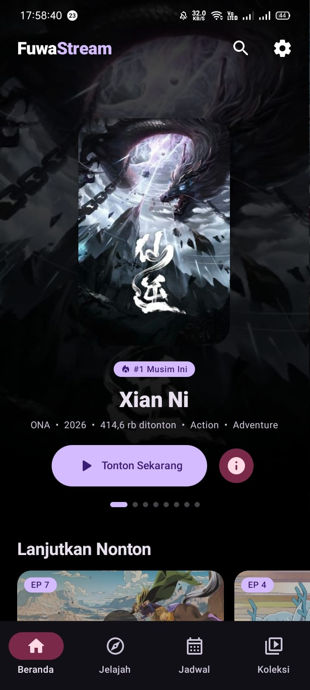
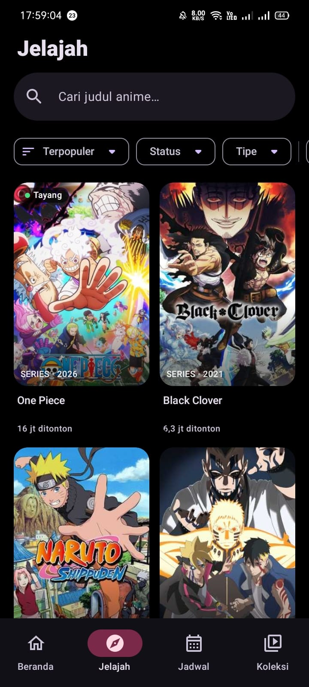
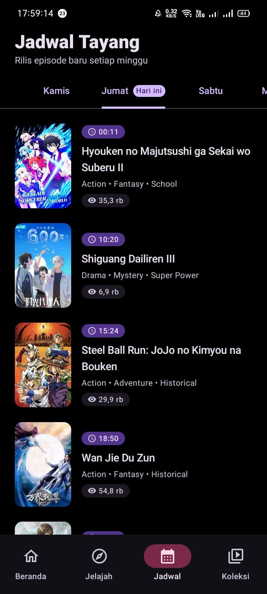
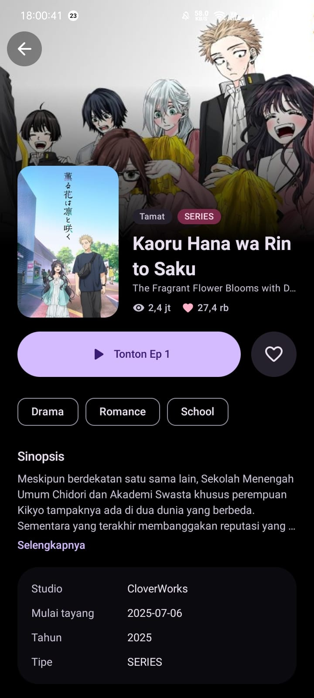
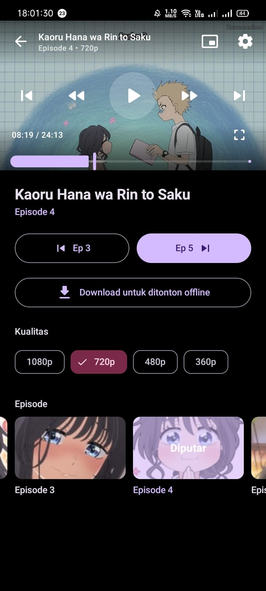
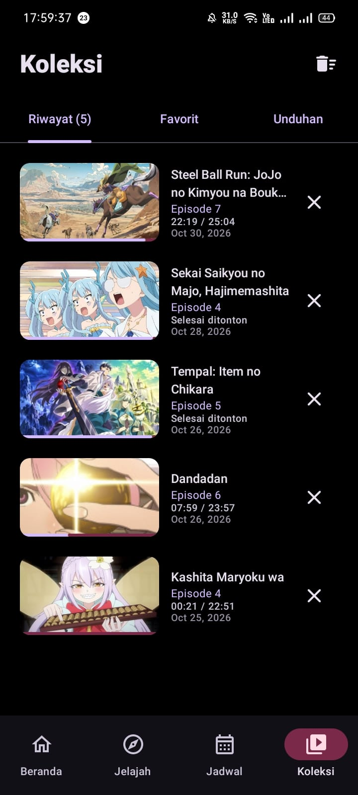

<div align="center">

# 🌸 FuwaStream

### Teman nonton anime di Android.

Aplikasi Android untuk menjelajahi dan menikmati anime dengan tampilan modern, fitur pemutar yang lengkap, serta pengalaman tanpa iklan.

<p>
  <a href="https://github.com/fuwanime/fuwastream/releases/latest">
    
  </a>
  <a href="https://github.com/fuwanime/fuwastream/stargazers">
    
  </a>
  <a href="https://github.com/fuwanime/fuwastream/network/members">
    
  </a>
  <a href="./LICENSE">
    
  </a>
</p>

[⬇️ Download APK](https://github.com/fuwanime/fuwastream/releases/latest) · [💬 Gabung Komunitas](https://chat.whatsapp.com/BD9q9veoNaAIhkdneKD4us) · [🐛 Laporkan Bug](https://github.com/fuwanime/fuwastream/issues)

</div>

---

## 📱 Screenshot

<table>
  <tr>
    <td align="center" width="33%">
      <strong>Beranda</strong><br>
      
    </td>
    <td align="center" width="33%">
      <strong>Jelajah Anime</strong><br>
      
    </td>
    <td align="center" width="33%">
      <strong>Jadwal Anime</strong><br>
      
    </td>
  </tr>
  <tr>
    <td align="center">
      <strong>Detail Anime</strong><br>
      
    </td>
    <td align="center">
      <strong>Video Player</strong><br>
      
    </td>
    <td align="center">
      <strong>Koleksi</strong><br>
      
    </td>
  </tr>
</table>

---

## ✨ Fitur

| Fitur | Deskripsi |
|---|---|
| 🏠 **Beranda** | Carousel anime unggulan, Lanjutkan Nonton, anime yang tayang hari ini dan musim ini, daftar terpopuler, serta pintasan genre. |
| 🔎 **Jelajah** | Cari anime, lihat riwayat pencarian, filter genre dan status, urutkan berdasarkan popularitas atau A–Z, dan jelajahi daftar dengan scroll tanpa batas. |
| 📅 **Jadwal** | Lihat jadwal tayang anime berdasarkan hari beserta jam rilisnya. |
| 📖 **Detail Anime** | Daftar episode, pencarian nomor episode, penanda sudah ditonton, progres menonton, tombol lanjutkan, dan favorit. |
| ▶️ **Pemutar Video** | Pilihan kualitas dan kecepatan 0.5×–2×, mode pas/isi layar, gestur ketuk dua kali, serta kontrol kecerahan dan volume. |
| ⏭️ **Lanjut Episode** | Hitung mundur otomatis menuju episode berikutnya dan lanjutkan pemutaran dari posisi terakhir. |
| 🪟 **Picture-in-Picture** | Lanjut menonton dalam jendela kecil saat keluar dari aplikasi. |
| 📥 **Download Offline** | Simpan episode, pilih kualitas unduhan, dan gunakan opsi unduh hanya melalui Wi-Fi. |
| ❤️ **Koleksi** | Akses riwayat tontonan, progres menonton, daftar favorit, dan episode yang sudah diunduh. |
| 🎨 **Pengaturan Tampilan** | Tema sistem, terang, gelap, Material You, dan mode hitam AMOLED. |

## ⬇️ Download & Instalasi

1. Buka halaman [**Latest Releases**](https://github.com/fuwanime/fuwastream/releases/latest).
2. Unduh file APK FuwaStream dari bagian **Assets**.
3. Buka file APK di perangkat Android.
4. Izinkan instalasi dari sumber tersebut jika Android memintanya.
5. Selesaikan instalasi, lalu buka FuwaStream.

**Persyaratan:** Android 7.0 (API 24) atau lebih baru.

> Unduh aplikasi hanya dari halaman rilis resmi FuwaStream. Pastikan file yang diunduh berasal dari repository ini.

## 🛠️ Build dari Source

Ingin menjalankan atau mengembangkan FuwaStream dari source code? Ikuti langkah berikut.

### Persyaratan

- JDK 17 atau lebih baru.
- Android SDK 36.
- Gradle yang kompatibel dengan konfigurasi proyek.

### Langkah build

```bash
# Clone repository
git clone https://github.com/fuwanime/fuwastream.git

# Masuk ke folder proyek
cd fuwastream

# Build APK debug
gradle assembleDebug
```

APK debug akan tersedia di:

```text
app/build/outputs/apk/debug/app-debug.apk
```

Untuk menjalankan unit test sebelum build:

```bash
gradle testDebugUnitTest assembleDebug
```

### Build otomatis

Repository ini menggunakan **GitHub Actions** untuk menjalankan test dan build APK release. Workflow berjalan saat ada push ke branch `main` atau saat tag dengan pola `v*` dibuat. APK hasil build diterbitkan melalui halaman [Releases](https://github.com/fuwanime/fuwastream/releases).

## 🧰 Teknologi

- **Kotlin** — bahasa pemrograman utama.
- **Jetpack Compose** — membangun antarmuka aplikasi.
- **Material 3** — komponen dan sistem desain.
- **Media3 / ExoPlayer** — pemutaran media.
- **Retrofit & OkHttp** — komunikasi jaringan/API.
- **Moshi** — parsing JSON.
- **Room** — penyimpanan data lokal.
- **DataStore** — penyimpanan preferensi aplikasi.
- **Kotlin Coroutines** — operasi asynchronous.
- **KSP** — pemrosesan kode.

## 📂 Struktur Proyek

Gambaran umum struktur kode utama:

```text
com.fuwanime
├── data/
│   ├── remote/       # Retrofit API dan DTO
│   └── local/        # Room dan DataStore
├── ui/               # Paket per layar (Screen + ViewModel)
│   ├── components/   # Komponen UI yang digunakan ulang
│   ├── navigation/   # Navigasi aplikasi
│   └── theme/        # Tema dan style
└── util/             # Helper dan utilitas
```

## 🤝 Kontribusi

Kontribusi, ide, dan laporan masalah sangat berarti untuk perkembangan FuwaStream!

1. **Fork** repository ini.
2. Buat branch baru untuk perubahanmu.
3. Lakukan perubahan dan uji aplikasi.
4. Buat **Pull Request** dengan penjelasan yang jelas.

Punya ide fitur atau menemukan bug? Silakan [buat Issue](https://github.com/fuwanime/fuwastream/issues) agar bisa didiskusikan.

## ⚠️ Catatan Konten

FuwaStream menggunakan API dan layanan pihak ketiga untuk memperoleh informasi atau sumber konten. Aplikasi ini tidak meng-host file video di repository ini. Ketersediaan konten dapat bergantung pada layanan pihak ketiga.

Pengguna bertanggung jawab untuk mematuhi hukum, hak cipta, dan ketentuan layanan yang berlaku di wilayah masing-masing. Nama, logo, dan aset pihak ketiga tetap menjadi milik pemegang haknya.

## 📄 Lisensi

Kode sumber proyek ini menggunakan lisensi **GNU General Public License v3.0 (GPL-3.0)**. Lihat file [LICENSE](./LICENSE) untuk informasi lengkap.

Lisensi kode tidak otomatis memberikan hak atas nama, logo, merek, maupun aset FuwaStream.

---

<div align="center">

**Dibuat dengan 💜 untuk para pecinta anime.**

Kalau FuwaStream bermanfaat buatmu, pertimbangkan untuk memberi ⭐ pada repository ini!

[GitHub](https://github.com/fuwanime/fuwastream) · [Komunitas WhatsApp](https://chat.whatsapp.com/BD9q9veoNaAIhkdneKD4us)

</div>
