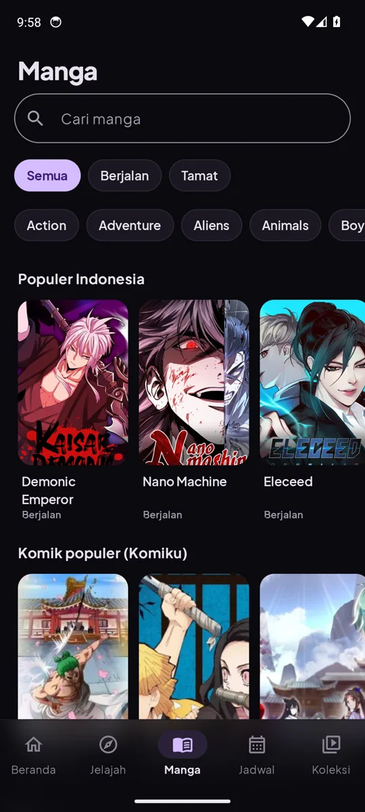
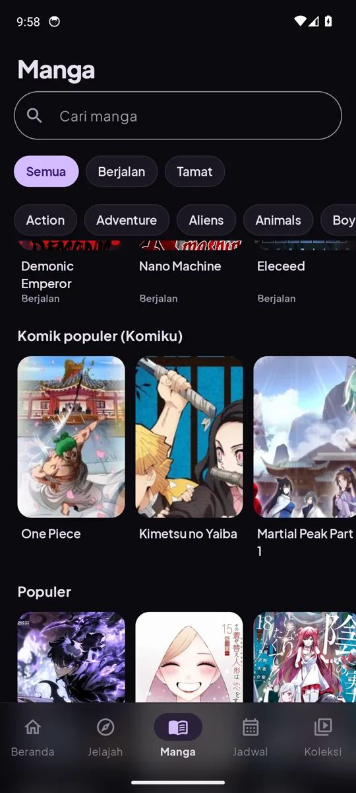
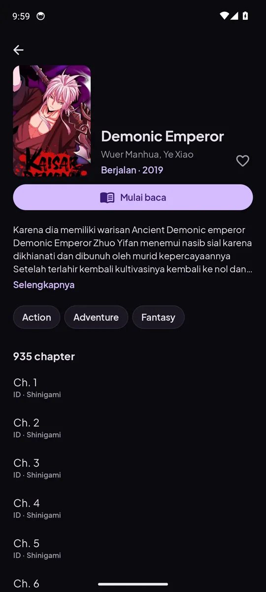
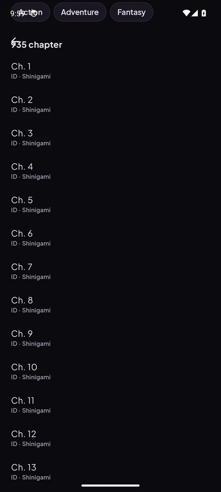
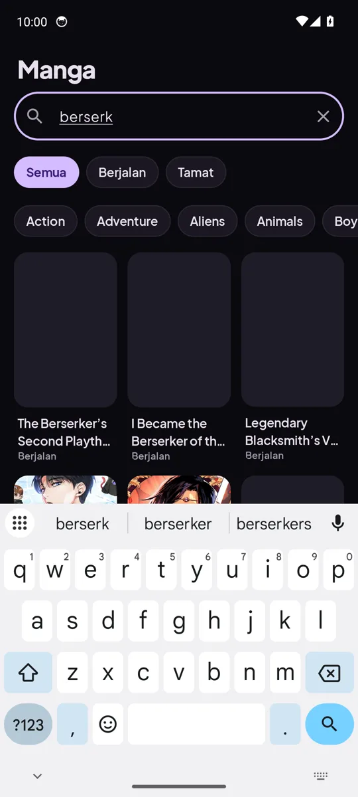
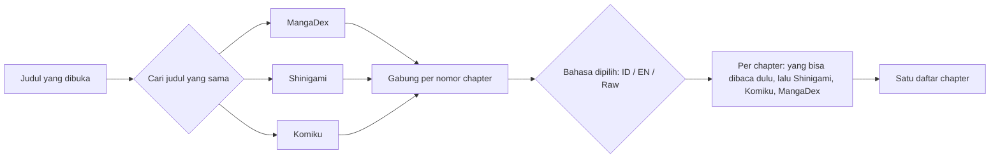
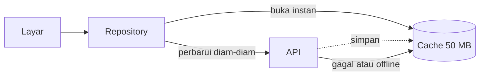

<div align="center">


<br>

**Nonton anime dan baca manga dalam satu aplikasi Android yang rapi, cepat, dan tanpa iklan.**

<p>
  <a href="https://github.com/fuwanime/fuwastream/releases/latest"></a>
  
  <a href="./LICENSE"></a>
</p>

<p>
  <a href="https://github.com/fuwanime/fuwastream/stargazers"></a>
  <a href="https://github.com/fuwanime/fuwastream/network/members"></a>
  <a href="https://github.com/fuwanime/fuwastream/issues"></a>
  
</p>

[**Download APK**](https://github.com/fuwanime/fuwastream/releases/latest) &nbsp;·&nbsp; [**Gabung Komunitas**](https://chat.whatsapp.com/BD9q9veoNaAIhkdneKD4us) &nbsp;·&nbsp; [**Laporkan Bug**](https://github.com/fuwanime/fuwastream/issues)

<br>


</div>

> [!TIP]
> **Baru:** tab **Manga** sendiri dengan tiga sumber yang digabung jadi satu daftar chapter, pilihan bahasa **ID / EN / Raw**, filter **Manga / Manhwa / Manhua**, dan **unduh chapter** untuk dibaca offline. Unduhan anime dan manga sekarang bisa disimpan ke **folder pilihanmu**.

---

## Tampilan

### Anime

<table>
  <tr>
    <td align="center" width="25%"><br><sub><b>Beranda</b><br>Sorotan musim ini</sub></td>
    <td align="center" width="25%"><br><sub><b>Jelajah</b><br>Cari, filter, urutkan</sub></td>
    <td align="center" width="25%"><br><sub><b>Jadwal</b><br>Rilis per hari</sub></td>
    <td align="center" width="25%"><br><sub><b>Detail</b><br>Episode dan info lengkap</sub></td>
  </tr>
  <tr>
    <td align="center"><br><sub><b>Pemutar</b><br>Kualitas, PiP, gestur</sub></td>
    <td align="center"><br><sub><b>Koleksi</b><br>Riwayat, favorit, unduhan</sub></td>
    <td align="center"><br><sub><b>Pengaturan</b><br>Atur sesukamu</sub></td>
    <td align="center"><br><sub><b>Mode offline</b><br>Data terakhir tetap ada</sub></td>
  </tr>
</table>

### Manga

<table>
  <tr>
    <td align="center" width="20%"><br><sub><b>Tab Manga</b><br>Cari dan filter</sub></td>
    <td align="center" width="20%"><br><sub><b>Rak</b><br>Populer dan terbaru</sub></td>
    <td align="center" width="20%"><br><sub><b>Detail</b><br>Info dan genre</sub></td>
    <td align="center" width="20%"><br><sub><b>Chapter</b><br>Grid dan rentang</sub></td>
    <td align="center" width="20%"><br><sub><b>Pencarian</b><br>Satu hasil per judul</sub></td>
  </tr>
</table>

## Fitur

<table>
  <tr>
    <td width="50%" valign="top">
      <h3>Temukan</h3>
      <ul>
        <li><b>Beranda sinematik</b>: sorotan musim ini, Lanjutkan Nonton, episode terbaru, Top 10, dan pintasan genre.</li>
        <li><b>Jelajah</b>: cari judul, genre, atau studio; filter tipe dan genre; urutkan populer, terbaru, atau A–Z.</li>
        <li><b>Jadwal tayang</b> per hari lengkap dengan jamnya.</li>
        <li><b>Anime serupa dan season terkait</b> langsung dari halaman detail.</li>
      </ul>
    </td>
    <td width="50%" valign="top">
      <h3>Tonton</h3>
      <ul>
        <li><b>Pemutar Media3</b>: pilih kualitas, kecepatan 0,5×–2×, mode pas atau isi layar.</li>
        <li><b>Gestur</b>: ketuk dua kali untuk maju atau mundur, geser untuk kecerahan dan volume.</li>
        <li><b>Lewati OP</b> otomatis, atau tombol <b>+85 detik</b>.</li>
        <li><b>Lanjut otomatis</b>, <b>Picture-in-Picture</b>, dan audio tetap jalan di latar.</li>
      </ul>
    </td>
  </tr>
  <tr>
    <td width="50%" valign="top">
      <h3>Baca manga</h3>
      <ul>
        <li><b>Tiga sumber jadi satu</b>: MangaDex, Shinigami, dan Komiku digabung per judul; tiap chapter diambil dari sumber terbaik.</li>
        <li><b>Bahasa per judul</b>: ID, EN, atau Raw, hanya yang tersedia untuk judul itu.</li>
        <li><b>Manga, Manhwa, Manhua</b> sebagai filter dan pintasan di beranda Manga.</li>
        <li><b>Reader vertikal</b> dengan pemilih chapter, tombol Prev dan Next, lanjut baca, dan mode hemat data.</li>
        <li><b>Konten dewasa</b> hanya muncul bila diaktifkan di Pengaturan (mati secara bawaan).</li>
      </ul>
    </td>
    <td width="50%" valign="top">
      <h3>Simpan dan offline</h3>
      <ul>
        <li><b>Unduh episode</b> dengan pilihan kualitas dan opsi hanya Wi-Fi.</li>
        <li><b>Unduh chapter manga</b> satu per satu atau satu rentang sekaligus, lalu baca tanpa internet.</li>
        <li><b>Simpan ke mana</b>: di dalam aplikasi, atau ke folder pilihanmu dengan satu folder per judul dan nama file urut ("Ep 01", "Ep 02", …).</li>
        <li><b>Koleksi</b>: riwayat, favorit, manga, dan unduhan dalam satu tempat; backup dan pulihkan data.</li>
      </ul>
    </td>
  </tr>
  <tr>
    <td width="50%" valign="top">
      <h3>Personal</h3>
      <ul>
        <li><b>Tema</b>: sistem, terang, gelap, hitam AMOLED, dan Material You.</li>
        <li><b>Statistik nonton</b> mingguan.</li>
        <li><b>Notifikasi episode baru</b> untuk anime favorit.</li>
      </ul>
    </td>
    <td width="50%" valign="top">
      <h3>Ringan</h3>
      <ul>
        <li><b>Tanpa iklan</b> dan tanpa akun.</li>
        <li><b>Update di dalam aplikasi</b> saat rilis baru tersedia.</li>
        <li><b>Startup cepat</b> berkat <i>baseline profile</i>.</li>
      </ul>
    </td>
  </tr>
</table>

## Cara kerja

### Satu manga dari tiga sumber



### Cepat dan tahan offline



- **Buka instan**: Beranda tampil dari data terakhir tanpa layar loading, lalu diperbarui di belakang layar.
- **Tetap jalan tanpa internet**: layar yang pernah dibuka tetap bisa dilihat, begitu juga episode dan chapter yang sudah diunduh.
- **Jaringan yang memblokir**: alamat sumber manga dicari lewat DNS-over-HTTPS bila DNS operator mengarahkannya ke halaman blokir.

## Download dan instalasi

| Langkah | |
| :---: | :--- |
| **1** | Buka halaman [**Latest Release**](https://github.com/fuwanime/fuwastream/releases/latest). |
| **2** | Unduh file **APK** dari bagian **Assets**. |
| **3** | Buka APK di HP, lalu izinkan instalasi dari sumber tersebut bila diminta. |
| **4** | Buka **FuwaStream** dan mulai menonton atau membaca. |

> [!IMPORTANT]
> Unduh APK **hanya** dari halaman rilis resmi repository ini. Butuh **Android 7.0 (API 24)** atau lebih baru.

## Teknologi

<p>
  
  
  
  
  
  
  
  
  
</p>

| Sumber data | Dipakai untuk |
| :--- | :--- |
| Animein | Katalog, jadwal, dan sumber pemutaran anime |
| AniList, AniSkip | Info tambahan anime dan penanda opening |
| MangaDex | Manga multi-bahasa (ID, EN, Raw) |
| Shinigami, Komiku | Manga berbahasa Indonesia |

## Build dari source

<details>
<summary><b>Persyaratan dan langkah build</b></summary>

<br>

**Persyaratan:** JDK 17+, Android SDK 36, dan Gradle yang kompatibel.

```bash
git clone https://github.com/fuwanime/fuwastream.git
cd fuwastream
gradle testDebugUnitTest assembleDebug
```

APK debug ada di `app/build/outputs/apk/debug/app-debug.apk`.

</details>

<details>
<summary><b>Build otomatis (GitHub Actions)</b></summary>

<br>

| Pemicu | Hasil |
|---|---|
| Push ke `main` | Test dan APK release, terbit di [Releases](https://github.com/fuwanime/fuwastream/releases) sebagai `build-N` |
| Tag `v*` | Rilis dengan nama versi tersebut |
| Manual · `smoke` / `qa` | Uji di emulator dengan screenshot dan rekaman layar |
| Manual · `profile` | Membuat ulang *baseline profile* |

Gambar anime di README ini dibuat dari screenshot QA dengan `scripts/readme_images.sh`.

</details>

<details>
<summary><b>Struktur proyek</b></summary>

<br>

```text
com.fuwanime
├── data/
│   ├── remote/       # API anime, DTO, cache dan status jaringan
│   ├── manga/        # MangaDex, Shinigami, Komiku, gabung sumber, unduhan manga
│   ├── meta/         # AniList dan AniSkip
│   ├── backup/       # Backup dan pulihkan data
│   └── local/        # Room dan DataStore
├── playback/         # Layanan pemutaran dan audio latar
├── ui/               # Paket per layar (Screen + ViewModel)
│   ├── components/   # Komponen UI yang dipakai ulang
│   ├── manga/        # Tab, detail, dan reader manga
│   ├── navigation/   # Navigasi aplikasi
│   └── theme/        # Tema, warna, tipografi
└── util/             # Helper dan utilitas
```

</details>

## Tim

| Nama | Peran |
| :--- | :--- |
| **YuzakiNetwork (Haruka Fuyune)** | Pendiri dan admin proyek: brand dan ikon, legal dan kepatuhan, rilis dan build CI, notifikasi episode, pengecek update, anime serupa, unduhan massal, filter tipe konten |
| **Andra** | Kolaborator dan kontributor: UI/UX (redesign, aksesibilitas, Statistik, Koleksi, multi-bahasa), Manga (MangaDex, Shinigami, Komiku, gabung sumber, reader, unduhan), Infrastruktur (CI dan QA, database dan backup, cache offline, DNS-over-HTTPS), Pemutar (Media3, PiP, audio latar, AniSkip) |

## Kontribusi

Kontribusi, ide, dan laporan masalah sangat berarti untuk FuwaStream.

1. **Fork** repository ini dan buat branch untuk perubahanmu.
2. Uji perubahanmu (`gradle testDebugUnitTest`).
3. Kirim **Pull Request** dengan penjelasan singkat dan cara mengujinya.

Punya ide fitur atau menemukan bug? [Buat Issue](https://github.com/fuwanime/fuwastream/issues), tapi cek dulu apakah sudah pernah dilaporkan.

## Catatan konten

> [!NOTE]
> FuwaStream adalah aplikasi klien dan **tidak meng-host file video maupun gambar manga**. Informasi dan sumber pemutaran berasal dari API atau layanan pihak ketiga, sehingga ketersediaan konten bergantung pada layanan tersebut. Pengguna bertanggung jawab mematuhi hukum, hak cipta, dan ketentuan layanan yang berlaku di wilayahnya. Nama, logo, dan aset pihak ketiga tetap milik pemegang haknya. Data dan gambar manga berasal dari MangaDex, Shinigami, dan Komiku beserta grup scanlation masing-masing. FuwaStream tidak menampilkan iklan.

## Privasi dan kepatuhan

[Kebijakan Privasi](./docs/legal/privacy.md) · [Ketentuan Layanan](./docs/legal/terms.md) · [Checklist Kepatuhan Play Store](./docs/compliance.md) · [Audit SDK Pihak Ketiga](./docs/third-party-sdk-audit.md) · [Jawaban Data Safety](./docs/play-data-safety.md)

## Lisensi

Kode sumber dilisensikan di bawah **[GNU General Public License v3.0](./LICENSE)**. Lisensi kode tidak memberikan hak atas nama, logo, merek, maupun aset FuwaStream.

---

<div align="center">


**Dibuat untuk para pecinta anime dan manga.**

<sub>Kalau FuwaStream bermanfaat buatmu, beri bintang pada repository ini. Itu sangat membantu.</sub>

[GitHub](https://github.com/fuwanime/fuwastream) · [Komunitas WhatsApp](https://chat.whatsapp.com/BD9q9veoNaAIhkdneKD4us) · [Releases](https://github.com/fuwanime/fuwastream/releases)

</div>
