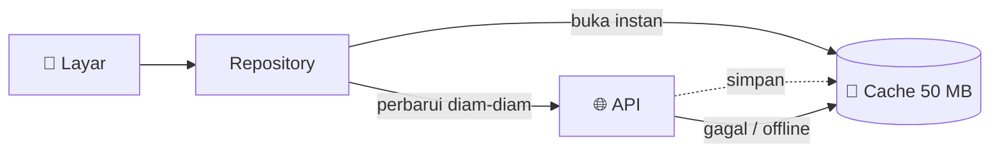

<div align="center">


<br>

**Jelajahi, tonton, dan simpan anime favoritmu — dalam satu aplikasi Android yang rapi, cepat, dan tanpa iklan.**

<p>
  <a href="https://github.com/fuwanime/fuwastream/releases/latest"></a>
  
  <a href="./LICENSE"></a>
</p>

<p>
  <a href="https://github.com/fuwanime/fuwastream/stargazers"></a>
  <a href="https://github.com/fuwanime/fuwastream/network/members"></a>
  <a href="https://github.com/fuwanime/fuwastream/issues"></a>
</p>

[**⬇️ Download APK**](https://github.com/fuwanime/fuwastream/releases/latest) &nbsp;·&nbsp; [**💬 Gabung Komunitas**](https://chat.whatsapp.com/BD9q9veoNaAIhkdneKD4us) &nbsp;·&nbsp; [**🐛 Laporkan Bug**](https://github.com/fuwanime/fuwastream/issues)

</div>

> [!TIP]
> **Baru:** FuwaStream sekarang **tahan offline**. Beranda langsung tampil dari data terakhir, layar yang pernah dibuka tetap bisa dilihat tanpa internet, dan aplikasi memperbarui diri diam-diam begitu kamu kembali online.

> [!NOTE]
> Aplikasi tersedia dalam Bahasa Indonesia, Bahasa Melayu, English, dan 中文 (简体). Terjemahan Melayu dan Mandarin dibuat dengan mesin; koreksi dari penutur asli sangat kami hargai.

---

## 📱 Tampilan

<table>
  <tr>
    <td align="center" width="25%"><br><sub><b>Beranda</b><br>Sorotan musim ini</sub></td>
    <td align="center" width="25%"><br><sub><b>Jelajah</b><br>Cari, filter, urutkan</sub></td>
    <td align="center" width="25%"><br><sub><b>Jadwal</b><br>Rilis per hari</sub></td>
    <td align="center" width="25%"><br><sub><b>Detail</b><br>Episode &amp; info lengkap</sub></td>
  </tr>
  <tr>
    <td align="center"><br><sub><b>Pemutar</b><br>Kualitas, PiP, gestur</sub></td>
    <td align="center"><br><sub><b>Koleksi</b><br>Riwayat, favorit, unduhan</sub></td>
    <td align="center"><br><sub><b>Pengaturan</b><br>Atur sesukamu</sub></td>
    <td align="center"><br><sub><b>Mode offline</b><br>Data terakhir tetap ada</sub></td>
  </tr>
</table>

## ✨ Fitur

<table>
  <tr>
    <td width="50%" valign="top">
      <h3>🔎 Temukan</h3>
      <ul>
        <li><b>Beranda sinematik</b> — sorotan musim ini, Lanjutkan Nonton, episode terbaru, Top 10 terpopuler, dan pintasan genre.</li>
        <li><b>Jelajah</b> — cari judul, genre, atau studio; filter tipe &amp; genre; urutkan populer, terbaru, atau A–Z.</li>
        <li><b>Jadwal tayang</b> — rilis per hari lengkap dengan jamnya.</li>
        <li><b>Anime serupa &amp; season terkait</b> — langsung dari halaman detail.</li>
      </ul>
    </td>
    <td width="50%" valign="top">
      <h3>▶️ Tonton</h3>
      <ul>
        <li><b>Pemutar Media3</b> — pilih kualitas, kecepatan 0,5×–2×, mode pas/isi layar.</li>
        <li><b>Gestur</b> — ketuk dua kali untuk maju/mundur, geser untuk kecerahan &amp; volume.</li>
        <li><b>Lewati OP</b> — otomatis, atau tombol <b>+85 detik</b> yang bisa dimatikan.</li>
        <li><b>Lanjut otomatis</b> ke episode berikutnya dan <b>Picture-in-Picture</b>.</li>
      </ul>
    </td>
  </tr>
  <tr>
    <td width="50%" valign="top">
      <h3>💾 Simpan</h3>
      <ul>
        <li><b>Koleksi</b> — riwayat per hari dengan sisa waktu tontonan, favorit, dan unduhan.</li>
        <li><b>Download offline</b> — pilih kualitas, opsi hanya lewat Wi-Fi.</li>
        <li><b>Notifikasi episode baru</b> untuk anime favoritmu.</li>
      </ul>
    </td>
    <td width="50%" valign="top">
      <h3>🎨 Personal</h3>
      <ul>
        <li><b>Tema</b> — sistem, terang, gelap, hitam AMOLED, dan Material You.</li>
        <li><b>Kualitas default</b> terpisah untuk Wi-Fi dan data seluler.</li>
        <li><b>Update di dalam aplikasi</b> — diberi tahu saat rilis baru tersedia.</li>
      </ul>
    </td>
  </tr>
</table>

## ⚡ Cepat &amp; tahan offline



- **Buka instan** — Beranda tampil dari data terakhir tanpa layar loading, lalu diperbarui di belakang layar.
- **Tetap jalan tanpa internet** — layar yang pernah dibuka tetap bisa dilihat; penanda kecil *“Offline · data 5 mnt lalu”* muncul di atas tab bar.
- **Startup lebih ringan** — jalur utama aplikasi dikompilasi lebih dulu lewat *baseline profile*.

## ⬇️ Download &amp; instalasi

1. Buka halaman [**Latest Release**](https://github.com/fuwanime/fuwastream/releases/latest).
2. Unduh file **APK** dari bagian **Assets**.
3. Buka APK di HP, lalu izinkan instalasi dari sumber tersebut jika diminta.
4. Selesai — buka **FuwaStream** dan mulai menonton.

> [!IMPORTANT]
> Unduh APK **hanya** dari halaman rilis resmi repository ini. Butuh **Android 7.0 (API 24)** atau lebih baru.

## 🧰 Teknologi

<p>
  
  
  
  
  
  
  
  
</p>

## 🛠️ Build dari source

<details>
<summary><b>Persyaratan &amp; langkah build</b></summary>

<br>

**Persyaratan:** JDK 17+, Android SDK 36, dan Gradle yang kompatibel.

```bash
git clone https://github.com/fuwanime/fuwastream.git
cd fuwastream
gradle testDebugUnitTest assembleDebug
```

APK debug ada di `app/build/outputs/apk/debug/app-debug.apk`.

</details>

<details>
<summary><b>Build otomatis (GitHub Actions)</b></summary>

<br>

| Pemicu | Hasil |
|---|---|
| Push ke `main` | Test + APK release, terbit di [Releases](https://github.com/fuwanime/fuwastream/releases) sebagai `build-N` |
| Tag `v*` | Rilis dengan nama versi tersebut |
| Manual · `smoke` / `qa` | Uji di emulator + screenshot & rekaman layar |
| Manual · `profile` | Membuat ulang *baseline profile* |

Gambar di README ini dibuat dari screenshot QA dengan `scripts/readme_images.sh`.

</details>

<details>
<summary><b>Struktur proyek</b></summary>

<br>

```text
com.fuwanime
├── data/
│   ├── remote/       # Retrofit API, DTO, cache & status jaringan
│   └── local/        # Room dan DataStore
├── ui/               # Paket per layar (Screen + ViewModel)
│   ├── components/   # Komponen UI yang dipakai ulang
│   ├── motion/       # Animasi & shared element
│   ├── navigation/   # Navigasi aplikasi
│   └── theme/        # Tema, warna, tipografi
└── util/             # Helper dan utilitas
```

</details>

## 🤝 Kontribusi

Kontribusi, ide, dan laporan masalah sangat berarti untuk FuwaStream!

1. **Fork** repository ini dan buat branch untuk perubahanmu.
2. Uji perubahanmu (`gradle testDebugUnitTest`).
3. Kirim **Pull Request** dengan penjelasan singkat dan cara mengujinya.

Punya ide fitur atau menemukan bug? [Buat Issue](https://github.com/fuwanime/fuwastream/issues) — cek dulu apakah sudah pernah dilaporkan.

## ⚠️ Catatan konten

> [!NOTE]
> FuwaStream adalah aplikasi klien dan **tidak meng-host file video**. Informasi dan sumber pemutaran berasal dari API atau layanan pihak ketiga, sehingga ketersediaan konten bergantung pada layanan tersebut. Pengguna bertanggung jawab mematuhi hukum, hak cipta, dan ketentuan layanan yang berlaku di wilayahnya. Nama, logo, dan aset pihak ketiga tetap milik pemegang haknya.

## 🔐 Privasi &amp; kepatuhan

[Kebijakan Privasi](./docs/legal/privacy.md) · [Ketentuan Layanan](./docs/legal/terms.md) · [Checklist Kepatuhan Play Store](./docs/compliance.md) · [Audit SDK Pihak Ketiga](./docs/third-party-sdk-audit.md) · [Jawaban Data Safety](./docs/play-data-safety.md)

## 📄 Lisensi

Kode sumber dilisensikan di bawah **[GNU General Public License v3.0](./LICENSE)**. Lisensi kode tidak memberikan hak atas nama, logo, merek, maupun aset FuwaStream.

---

<div align="center">


**Dibuat dengan 💜 untuk para pecinta anime.**

<sub>Kalau FuwaStream bermanfaat buatmu, beri ⭐ pada repository ini — itu sangat membantu!</sub>

[GitHub](https://github.com/fuwanime/fuwastream) · [Komunitas WhatsApp](https://chat.whatsapp.com/BD9q9veoNaAIhkdneKD4us) · [Releases](https://github.com/fuwanime/fuwastream/releases)

</div>
