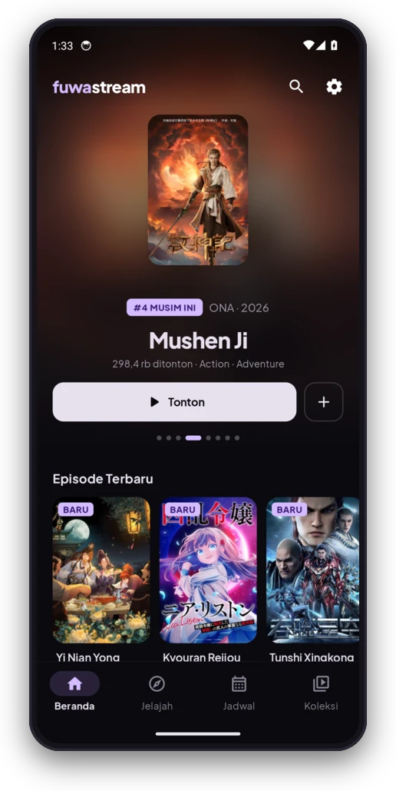
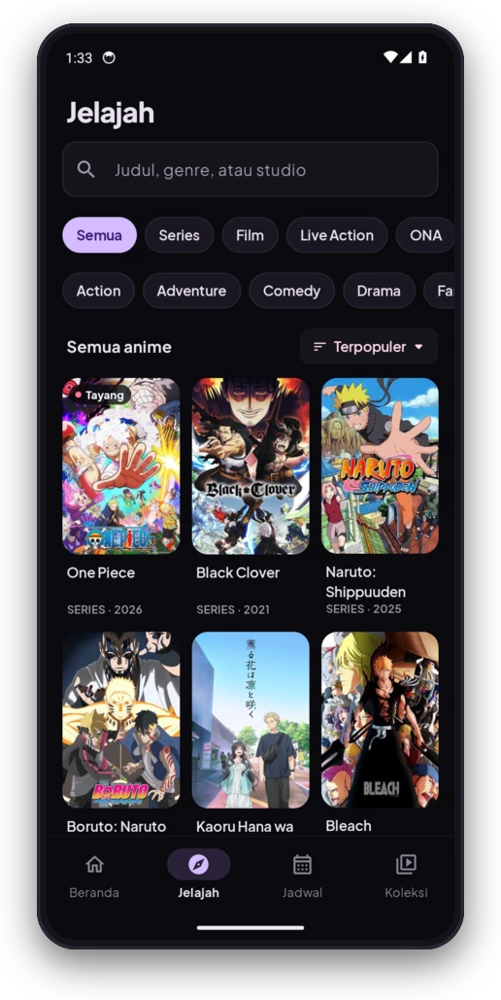
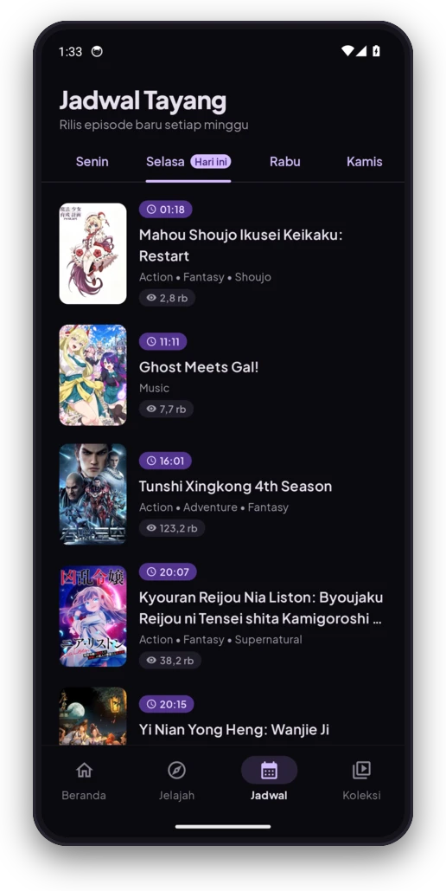
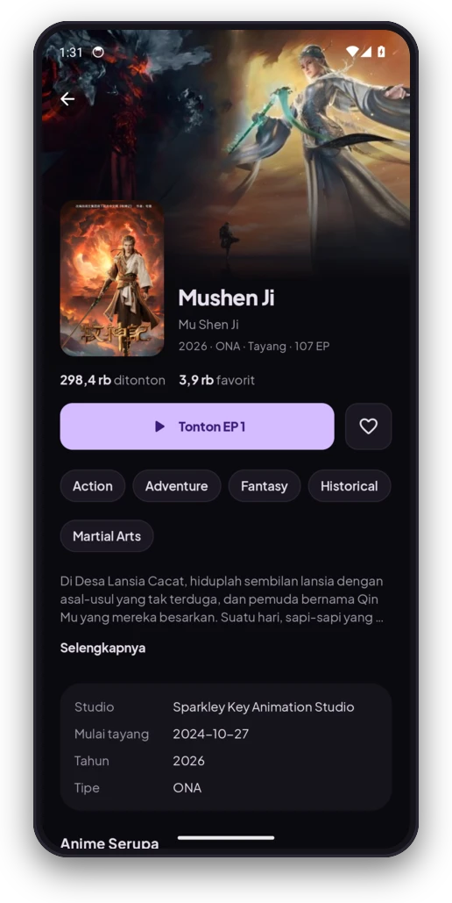
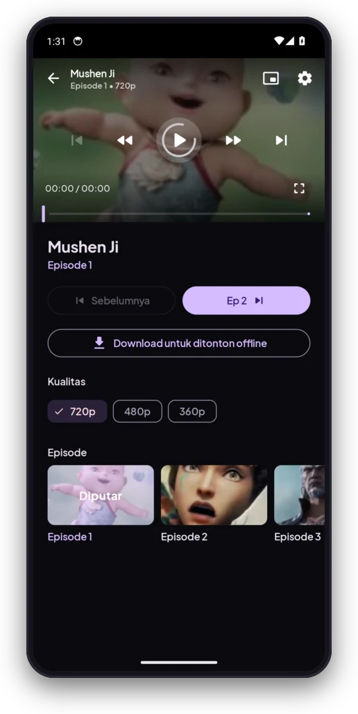
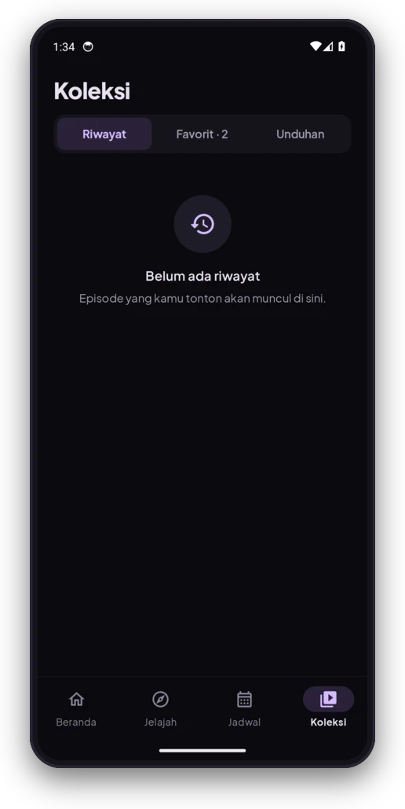
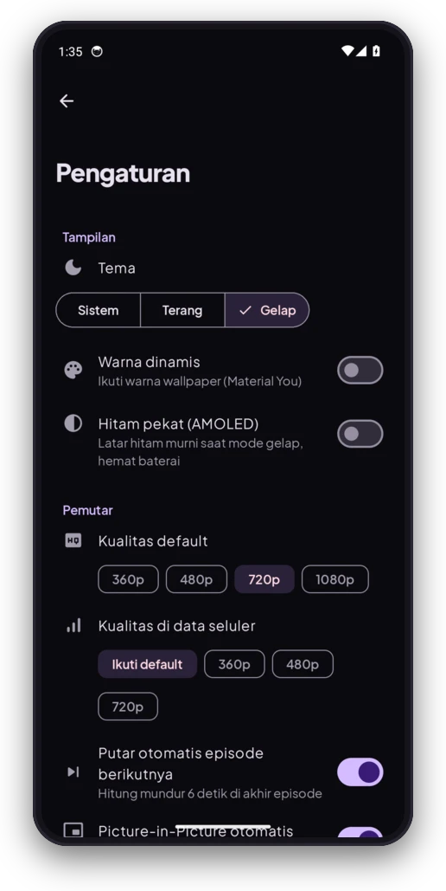
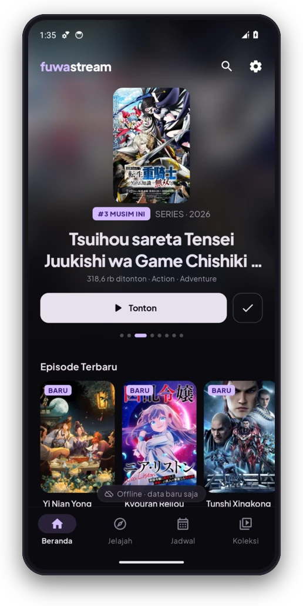
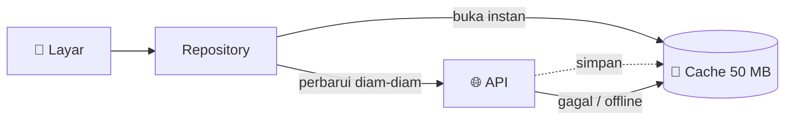

<div align="center">


<br>

**Nonton anime dan baca manga dalam satu aplikasi Android yang rapi, cepat, dan tanpa iklan.**

<p>
  <a href="https://github.com/fuwanime/fuwastream/releases/latest"></a>
  
  <a href="./LICENSE"></a>
</p>

<p>
  <a href="https://github.com/fuwanime/fuwastream/stargazers"></a>
  <a href="https://github.com/fuwanime/fuwastream/network/members"></a>
  <a href="https://github.com/fuwanime/fuwastream/issues"></a>
</p>

[**⬇️ Download APK**](https://github.com/fuwanime/fuwastream/releases/latest) &nbsp;·&nbsp; [**💬 Gabung Komunitas**](https://chat.whatsapp.com/BD9q9veoNaAIhkdneKD4us) &nbsp;·&nbsp; [**🐛 Laporkan Bug**](https://github.com/fuwanime/fuwastream/issues)

</div>

> [!TIP]
> **Tahan offline.** Layar yang pernah dibuka tetap tampil dari data terakhir tanpa internet, lalu diperbarui diam-diam begitu kamu kembali online. Episode dan chapter yang sudah diunduh bisa dinikmati kapan saja.

> [!NOTE]
> Aplikasi tersedia dalam Bahasa Indonesia, Bahasa Melayu, English, dan 中文 (简体). Terjemahan Melayu dan Mandarin dibuat dengan mesin; koreksi dari penutur asli sangat kami hargai.

---

## 📱 Tampilan

<table>
  <tr>
    <td align="center" width="25%"><br><sub><b>Beranda</b><br>Sorotan musim ini</sub></td>
    <td align="center" width="25%"><br><sub><b>Jelajah</b><br>Cari, filter, urutkan</sub></td>
    <td align="center" width="25%"><br><sub><b>Jadwal</b><br>Rilis per hari</sub></td>
    <td align="center" width="25%"><br><sub><b>Detail</b><br>Episode &amp; info lengkap</sub></td>
  </tr>
  <tr>
    <td align="center"><br><sub><b>Pemutar</b><br>Kualitas, PiP, gestur</sub></td>
    <td align="center"><br><sub><b>Koleksi</b><br>Riwayat, favorit, unduhan</sub></td>
    <td align="center"><br><sub><b>Pengaturan</b><br>Atur sesukamu</sub></td>
    <td align="center"><br><sub><b>Mode offline</b><br>Data terakhir tetap ada</sub></td>
  </tr>
</table>

## ✨ Fitur

<table>
  <tr>
    <td width="50%" valign="top">
      <h3>🔎 Temukan</h3>
      <ul>
        <li><b>Beranda</b>: sorotan musim ini, Lanjutkan Nonton, episode terbaru, dan Top 10.</li>
        <li><b>Jelajah</b>: cari judul, genre, atau studio; filter tipe (Series, Film, ONA, OVA, Live Action); urutkan populer, terbaru, atau A–Z.</li>
        <li><b>Jadwal tayang</b>: rilis per hari lengkap dengan jamnya.</li>
        <li><b>Anime serupa &amp; season berikutnya</b> langsung dari halaman detail.</li>
        <li><b>Manga</b>: baca chapter Indonesia, Inggris, atau Raw dengan reader vertikal, lanjut dari halaman terakhir, dan mode hemat data. Judul yang sama dari tiga sumber digabung jadi satu daftar.</li>
      </ul>
    </td>
    <td width="50%" valign="top">
      <h3>▶️ Tonton</h3>
      <ul>
        <li><b>Pemutar Media3</b>: kualitas 360p–1080p, kecepatan 0,5×–2×, mode pas atau isi layar.</li>
        <li><b>Gestur</b>: ketuk dua kali untuk maju atau mundur, geser untuk kecerahan dan volume.</li>
        <li><b>Lewati opening</b>: otomatis lewat AniSkip, atau tombol <b>+85 dtk</b>.</li>
        <li><b>Lanjut otomatis</b> ke episode berikutnya, plus <b>Picture-in-Picture</b>.</li>
        <li><b>Audio latar</b>: suara tetap terdengar saat layar mati.</li>
      </ul>
    </td>
  </tr>
  <tr>
    <td width="50%" valign="top">
      <h3>💾 Simpan</h3>
      <ul>
        <li><b>Koleksi</b>: riwayat, favorit, manga, dan unduhan dalam satu tempat.</li>
        <li><b>Download offline</b>: satu episode, semua episode, satu chapter, atau rentang 1–100; simpan di dalam aplikasi atau folder pilihanmu.</li>
        <li><b>Backup &amp; pulihkan</b> data ke folder pilihan, lalu pakai di HP lain.</li>
        <li><b>Notifikasi episode baru</b> untuk anime favoritmu.</li>
      </ul>
    </td>
    <td width="50%" valign="top">
      <h3>🎨 Personal</h3>
      <ul>
        <li><b>Tema</b>: sistem, terang, gelap, hitam AMOLED, dan Material You.</li>
        <li><b>Kualitas bawaan</b> terpisah untuk Wi-Fi dan data seluler.</li>
        <li><b>Statistik nonton</b>: total waktu, episode selesai, minggu aktif, genre teratas, dan rekap yang bisa dibagikan.</li>
        <li><b>Update di dalam aplikasi</b>: diberi tahu saat rilis baru tersedia.</li>
      </ul>
    </td>
  </tr>
</table>

## 📚 Manga: satu judul, tiga sumber

FuwaStream mencari judul yang sama di **MangaDex**, **Shinigami**, dan **Komiku**, lalu menggabungkannya jadi satu daftar chapter. Tiap chapter diambil dari sumber yang bisa dibaca dan paling bagus.

<p align="center">
  <br>
  <sub>Urutan prioritas tiap chapter: yang bisa dibaca di aplikasi lebih dulu, lalu Shinigami, Komiku, dan MangaDex.</sub>
</p>

## ⚡ Cepat &amp; tahan offline



- **Buka instan**: layar yang pernah dibuka tampil dari data terakhir tanpa loading, lalu diperbarui di belakang layar.
- **Tetap jalan tanpa internet**: penanda kecil *Offline* muncul di atas tab bar saat tidak ada koneksi.
- **Startup lebih ringan**: jalur utama aplikasi dikompilasi lebih dulu lewat *baseline profile*.

## ⬇️ Download &amp; instalasi

1. Buka halaman [**Latest Release**](https://github.com/fuwanime/fuwastream/releases/latest).
2. Unduh file **APK** dari bagian **Assets**.
3. Buka APK di HP, lalu izinkan instalasi dari sumber tersebut jika diminta.
4. Selesai, buka **FuwaStream** dan mulai menonton.

> [!IMPORTANT]
> Unduh APK **hanya** dari halaman rilis resmi repository ini. Butuh **Android 7.0 (API 24)** atau lebih baru.

## 🧰 Teknologi

<p>
  
  
  
  
  
  
  
  
</p>

| Sumber data | Dipakai untuk |
| :--- | :--- |
| Animein, Kuramanime | Katalog, jadwal, dan sumber pemutaran anime |
| AniList, AniSkip | Info tambahan anime dan penanda opening |
| MangaDex | Manga multi-bahasa (Indonesia, Inggris, Raw) |
| Shinigami, Komiku | Manga berbahasa Indonesia |

## 🛠️ Build dari source

<details>
<summary><b>Persyaratan &amp; langkah build</b></summary>

<br>

**Persyaratan:** JDK 17+, Android SDK 36, dan Gradle yang kompatibel.

```bash
git clone https://github.com/fuwanime/fuwastream.git
cd fuwastream
gradle testDebugUnitTest assembleDebug
```

APK debug ada di `app/build/outputs/apk/debug/app-debug.apk`.

</details>

<details>
<summary><b>Build otomatis (GitHub Actions)</b></summary>

<br>

| Pemicu GitHub Actions | Hasil |
|---|---|
| Push ke `main` / PR | Menjalankan unit test dan kompilasi APK/AAB sebagai artefak verifikasi CI |
| Rilis SemVer manual (`workflow_dispatch`) | Bump versi SemVer (Major/Minor/Patch) dan publikasi rilis di [Releases](https://github.com/fuwanime/fuwastream/releases) |
| Tag `v*.*.*` | Build rilis dan publikasi otomatis sesuai tag SemVer |
| Manual · `smoke` / `qa` | Uji di emulator Android dengan tangkapan layar dan rekaman |
| Manual · `profile` | Membuat ulang *baseline profile* untuk optimasi performa *cold start* |

</details>

<details>
<summary><b>Struktur proyek</b></summary>

<br>

```text
com.fuwanime
├── data/
│   ├── remote/       # API anime, DTO, cache dan status jaringan
│   ├── manga/        # MangaDex, Shinigami, Komiku, gabung sumber, unduhan manga
│   ├── meta/         # AniList dan AniSkip
│   ├── backup/       # Backup dan pulihkan data
│   └── local/        # Room dan DataStore
├── playback/         # Layanan pemutaran dan audio latar
├── ui/               # Paket per layar (Screen + ViewModel)
│   ├── components/   # Komponen UI yang dipakai ulang
│   ├── manga/        # Tab, detail, dan reader manga
│   ├── navigation/   # Navigasi aplikasi
│   └── theme/        # Tema, warna, tipografi
└── util/             # Helper dan utilitas
```

</details>

## 👥 Tim

| Nama | Peran |
| :--- | :--- |
| **YuzakiNetwork (Haruka Fuyune)** | Pendiri &amp; admin proyek: brand &amp; ikon, legal &amp; kepatuhan, fitur anime &amp; katalog, infrastruktur &amp; build |
| **Andra** | Kolaborator &amp; kontributor: UI/UX &amp; aksesibilitas, multi-bahasa, ekosistem manga, pemutar video, data &amp; offline, CI &amp; QA |
| **BANG SYAII (LT-SYAII)** | Kontributor: sumber Kuramanime, notifikasi rilis, toggle konten dewasa |

<details>
<summary><b>Lihat rincian kontribusi</b></summary>

<br>

**YuzakiNetwork (Haruka Fuyune)** · Pendiri dan admin proyek

- **Brand dan identitas visual**: Desain ikon peluncur geometris (*petal-play*), *mask preview*, ikon 512px, dan *wordmark* FuwaStream.
- **Legal, privasi, dan kepatuhan**: Dokumen kepatuhan Play Store, Kebijakan Privasi, Ketentuan Layanan, *age-gate* 13+, dan fungsi hapus semua data.
- **Fitur anime dan katalog**: Pengecek *update* otomatis dengan *in-app changelog*, notifikasi episode baru, rekomendasi anime serupa (dengan *fallback cache*), filter tipe konten di Jelajah (Series, Film, ONA, OVA, Special), dan unduhan massal awal.
- **Infrastruktur dan build**: Konfigurasi awal proyek, lisensi GPL-3.0, *build* bundle AAB, alur smoke test di branch qa-smoke, dan formula *versionCode* deterministik untuk F-Droid.

**Andra** · Kolaborator dan kontributor

- **UI/UX dan desain sinematik**: *Redesign* antarmuka sinematik Material 3 (Beranda *ambient blur*, Jelajah *multi-chip* dan *collapsing header*, detail sinematik dengan *poster tinting*), tab Koleksi dengan badge "N baru" dan multi-pilih, grafik waktu tonton 7 hari, kartu rekap statistik, serta adaptasi tema Material You (terang, gelap, AMOLED).
- **Aksesibilitas dan multi-bahasa**: Dukungan penuh TalkBack (*merged nodes* dan label deskriptif), batas skala font 1.3x tanpa teks terpotong, tata letak layar lebar (*navigation rail*), serta pelokalan 4 bahasa (Indonesia, Melayu, Inggris, Mandarin).
- **Ekosistem manga**: Integrasi multi-sumber (MangaDex, Shinigami, Komiku 8.000+ judul), penggabung daftar chapter lintas sumber dengan filter bahasa (ID, EN, Raw) dan kategori (Manga, Manhwa, Manhua), *vertical reader* dengan DNS-over-HTTPS (DoH) untuk membuka blokir ISP, serta antrean unduh chapter *offline*.
- **Pemutar video (Media3 ExoPlayer)**: Audio latar belakang (*MediaSessionService*) saat layar mati atau di latar belakang, Picture-in-Picture (PiP) adaptif, integrasi AniSkip (otomatis/tombol +85 dtk), *gesture* layar penuh, dan tampilan bersih saat *buffering*.
- **Data, offline, dan penyimpanan**: Arsitektur *cache-first* (tahan *offline*), pencadangan dan pemulihan data lokal (Format v2), pemilihan folder unduhan eksternal via Storage Access Framework (SAF), serta widget *Glance* dan *Dynamic Shortcuts* di layar utama.
- **Infrastruktur, CI, dan QA**: *Suite smoke test* dan skenario QA komprehensif di emulator Android, generator Baseline Profile otomatis di CI, alur rilis SemVer terstandarisasi, dan dokumentasi aset resolusi tinggi.

**BANG SYAII (LT-SYAII)** · Kontributor

- **Sumber & penemuan anime**: Integrasi sumber Kuramanime (pencarian, detail, episode, pemutaran native) dan penyatuan hasil ke daftar anime utama di Jelajah.
- **Notifikasi rilis**: Perbaikan deteksi rilis manga (`readableAt`) dan episode anime (penyegaran cache/penyelesaian status) agar notifikasi tidak macet, serta notifikasi pembaruan aplikasi (cek saat dibuka dan WorkManager berkala).
- **Konten dewasa**: Perluasan toggle konten dewasa ke anime (filter genre eksplisit Ecchi/Erotica/Hentai), sinkron dengan preferensi manga dan perilaku katalog/daftar terkait.

</details>

## 🤝 Kontribusi

Kontribusi, ide, dan laporan masalah sangat berarti untuk FuwaStream!

1. **Fork** repository ini dan buat branch untuk perubahanmu.
2. Uji perubahanmu (`gradle testDebugUnitTest`).
3. Kirim **Pull Request** dengan penjelasan singkat dan cara mengujinya.

Punya ide fitur atau menemukan bug? [Buat Issue](https://github.com/fuwanime/fuwastream/issues) dan cek dulu apakah sudah pernah dilaporkan.

## ⚠️ Catatan konten

> [!NOTE]
> FuwaStream adalah aplikasi klien dan **tidak meng-host video maupun gambar manga**. Informasi dan sumber pemutaran datang dari layanan pihak ketiga, jadi ketersediaannya bergantung pada layanan tersebut. Pengguna bertanggung jawab mematuhi hukum, hak cipta, dan ketentuan layanan di wilayahnya. Nama, logo, dan aset pihak ketiga tetap milik pemegang haknya; gambar manga berasal dari MangaDex, Shinigami, dan Komiku beserta grup scanlation masing-masing.

## 🔐 Privasi &amp; kepatuhan

[Kebijakan Privasi](./docs/legal/privacy.md) · [Ketentuan Layanan](./docs/legal/terms.md) · [Checklist Kepatuhan Play Store](./docs/compliance.md) · [Audit SDK Pihak Ketiga](./docs/third-party-sdk-audit.md) · [Jawaban Data Safety](./docs/play-data-safety.md)

## 📄 Lisensi

Kode sumber dilisensikan di bawah **[GNU General Public License v3.0](./LICENSE)**. Lisensi kode tidak memberikan hak atas nama, logo, merek, maupun aset FuwaStream.

Font **Plus Jakarta Sans** dilisensikan di bawah SIL Open Font License. Salinan lisensi disertakan di `app/src/main/assets/licenses/PlusJakartaSans-OFL.txt`.

---

<div align="center">


**Dibuat dengan 💜 untuk para pecinta anime dan manga.**

<sub>Kalau FuwaStream bermanfaat buatmu, beri ⭐ pada repository ini. Itu sangat membantu!</sub>

[GitHub](https://github.com/fuwanime/fuwastream) · [Komunitas WhatsApp](https://chat.whatsapp.com/BD9q9veoNaAIhkdneKD4us) · [Releases](https://github.com/fuwanime/fuwastream/releases)

</div>
